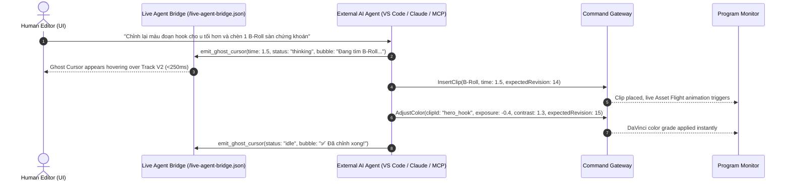
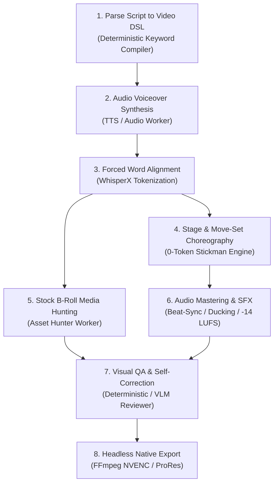

# 🤖 AI EXECUTION SPECIFICATION: MODE A & MODE B (`AI_EXECUTION_SPEC.md`)

> **Document Version:** 2.0.0  
> **Target Subsystems:** Dual AI Engine, Agent HUD, Command Gateway, Batch DAG  
> **Status:** Authoritative Specification  

---

## 1. DUAL-MODE EXECUTION PHILOSOPHY

Autonomous Studio Pro rejects the one-size-fits-all model of AI video editing. Real-world creator workflows require two fundamentally different interaction patterns:

1. **Mode A (Live Pair-Editing):** The AI acts as a collaborative co-pilot inside the active editing session, with conjoined ghost cursors, sub-250ms latency, and immediate visual feedback.
2. **Mode B (Batch Production DAG):** The AI acts as a headless film studio, transforming a script or topic into an exported master video through an offline, persistent, cost-controlled task graph.

---

## 2. MODE A: LIVE AI PAIR-EDITING SPECIFICATION



### 2.1 Concurrency & Human Takeover
- **Optimistic Concurrency Control (OCC):** Every agent command specifies `expectedRevision`. If the human editor moves or trims a clip while the agent is reasoning, the agent's command fails gracefully with `CONCURRENCY_CONFLICT`. The agent queries the new revision and re-applies its edits.
- **Instant Pause & Takeover:** The user can click **Pause & Take Over** in the Agent HUD at any millisecond. This sets `autonomousMode: 'paused-by-user'`, instantly locking all tracks against incoming AI mutations while preserving in-flight ghost cursor bubbles for review.

---

## 3. MODE B: BATCH PRODUCTION DAG SPECIFICATION

Mode B compiles a raw script or Video DSL document into a Directed Acyclic Graph (DAG) of executable worker tasks.



### 3.1 Task Lifecycle & State Machine
Every task in the DAG transitions through strictly defined states:

```
  [ PENDING ] ────────► [ RUNNING ] ────────► [ COMPLETED ]
                             │                      │
                             ├────────► [ FAILED ]  ▼
                             │                 [ NEEDS_REVIEW ]
                             └────────► [ CANCELLED ]
```

- **`PENDING`:** Waiting for upstream dependency tasks to complete.
- **`RUNNING`:** Claimed by an isolated process worker. Emits streaming progress (`0..100%`).
- **`COMPLETED`:** Output artifacts verified on disk (SHA-256 hash stored). Checkpoint persisted.
- **`FAILED`:** Worker crashed or returned non-zero exit. Retries up to `maxRetries` (default: 2).
- **`NEEDS_REVIEW`:** QA critic score below threshold ($< 7.0/10$). Awaits human sign-off or auto-refinement.
- **`CANCELLED`:** Aborted by user or invalidated by upstream edits.

### 3.2 Checkpoint Persistence & Partial Rebuilds
- Every completed task writes its output artifacts into `.vproj/dag_cache/<task_hash>/`.
- **Partial Rebuild Invariant:** If a user modifies only Scene 3's narration, the DAG scheduler recalculates task hashes. Only tasks dependent on Scene 3 are invalidated. Scenes 1, 2, 4, and 5 retain their cached audio, B-roll, and rendered chunks, reducing re-render time from minutes to seconds!

---

## 4. TOKEN BUDGET & COST CONTROL POLICIES

To prevent catastrophic token runaways, production playbooks enforce strict resource allocation ceilings:

| Autonomy Tier | Token Budget / Min of Video | Built-in Stage / Move-Sets | Web Stock Media | Heavy Neural / Generative AI |
| :--- | :---: | :---: | :---: | :---: |
| **Tier 0: Zero-AI** | **0 tokens** | **100%** | 0% | 0% |
| **Tier 1: Eco-Puppeteer** | $\le 750\text{ tokens}$ | **80%** | 15% | 5% |
| **Tier 2: Hybrid-Pro** | $\le 2{,}500\text{ tokens}$ | **65%** | 25% | 10% |
| **Tier 3: Full-AI Max** | $\le 10{,}000\text{ tokens}$ | **30%** | 40% | 30% |

If a task reaches 90% of its token ceiling, the orchestrator automatically downgrades subsequent scenes to pre-built deterministic move-sets, ensuring the video finishes within budget.

