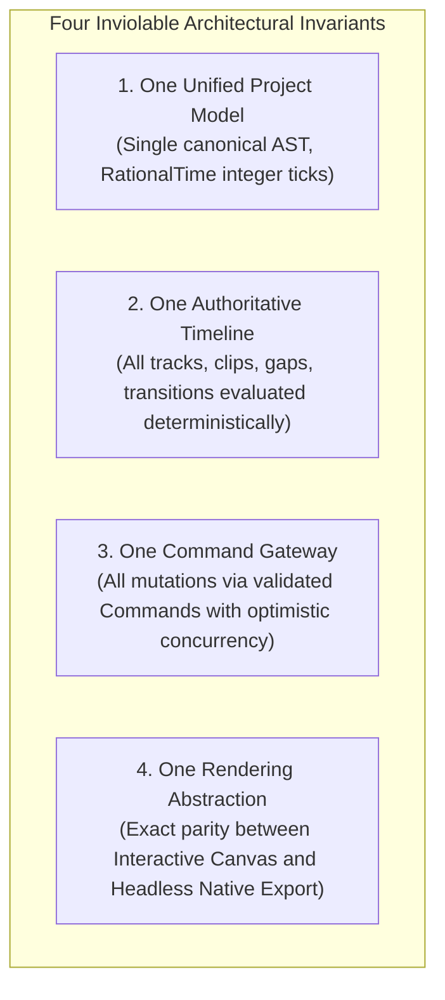
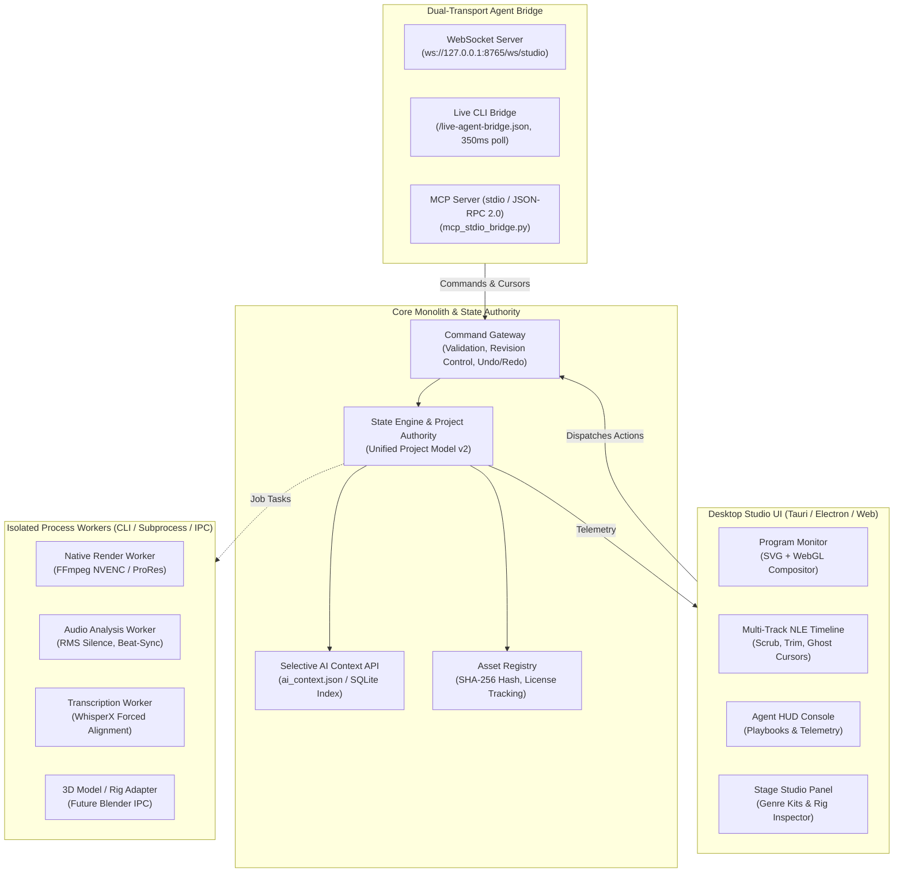
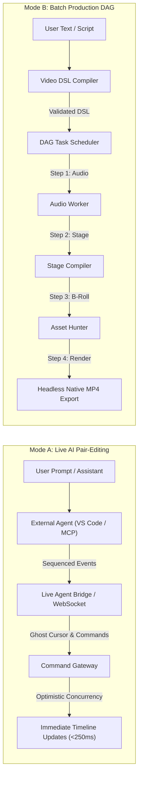

# 🏛️ SYSTEM ARCHITECTURE SPECIFICATION (`ARCHITECTURE.md`)

> **System Name:** Autonomous Studio Pro  
> **Architecture Style:** Modular Monolith with Isolated Process Workers  
> **Specification Version:** 2.0.0  
> **Status:** Active Reference Standard  

---

## 1. ARCHITECTURAL VISION & INVIOLABLE INVARIANTS

Autonomous Studio Pro is an AI-native desktop non-linear video editing (NLE) and generative animation system. It bridges high-speed interactive human editing (Premiere/DaVinci style) with multi-agent autonomous video generation (Stickman puppet animation, 2.5D camera choreography, neural VFX, and automated sound design).

To prevent architectural entropy, race conditions between human and AI editors, and floating-point frame misalignment, the entire system enforces **Four Inviolable Architectural Invariants**:

### Invariant 1: One Unified Project Model
There is only one canonical data model for a video project. Raw scripts, Video DSL definitions, live user interactions, and external agent commands all compile into this unified document graph. No plugin, agent, or worker may maintain an out-of-band representation of timeline state.

### Invariant 2: One Authoritative Timeline
Time is strictly represented as integer fraction ticks (`RationalTime: { value: i64, rate: i64 }`). Floating-point seconds are strictly forbidden for storage, indexing, and cutting arithmetic. Every frame index is exact and immutable across platforms (Windows, macOS, Linux).

### Invariant 3: One Command Gateway
Neither human users nor AI agents directly mutate project state. Every modification passes through the **Command Gateway**, which validates schema integrity, enforces optimistic concurrency via `expectedRevision`, produces atomic undo/redo steps, and broadcasts telemetry to live ghost cursors.

### Invariant 4: One Rendering Abstraction
Preview rendering (React SVG / WebGL2 / WebGPU) and final headless export (Rust / FFmpeg / NVENC / AVAssetWriter) execute identical visual choreography equations. A 2.5D camera pan, stickman skeletal move-set, or shader transition must produce visually equivalent results whether previewed at 60fps in the browser or rendered to a 4K ProRes master.

---

## 2. MODULAR MONOLITH + ISOLATED WORKERS TOPOLOGY

The application is structured as a **Modular Monolith** for core state and user interface, paired with **Isolated Process Workers** for CPU/GPU-intensive, long-running, or failure-prone tasks.

### Module Boundaries:
- `packages/core-schema`: Pure TypeScript definitions (Unified Project Model, RationalTime, Video DSL, Command Contracts, Asset Registry). Zero DOM/Node dependencies.
- `packages/stage-engine`: Deterministic 2D skeletal bone kinematics, 2.5D multi-plane camera choreography rigs, and genre widget generators.
- `packages/shader-library`: GLSL/WGSL transition shaders, DaVinci-style color grading math, and GPU post-processing effects.
- `packages/motion-engine`: Procedural React/Canvas templates (Kinetic Typography, News Highlight, Lower Thirds).
- `packages/mcp-bridge`: Tool registry, Prompt Blueprints, and Standard Operating Procedure (SOP) playbooks for external AI models.
- `apps/desktop`: High-performance 5-panel NLE workspace, real-time compositor, and audio playback engine.
- `services/ai-sidecar`: FastAPI daemon hosting the MCP stdio bridge, deterministic edit plan refiners, and audio/vision pipeline wrappers.

---

## 3. DUAL AI EXECUTION MODES: MODE A VS. MODE B

Autonomous Studio Pro solves the fundamental tension between **real-time pair programming** and **cost-effective batch video generation** by supporting two distinct execution modes:

### Mode A: Live AI Pair-Editing (Interactive)
- **Target Use Case:** Fine-tuning an existing timeline, tweaking color grades, moving cuts, re-timing captions, or having an AI director audition alternative shots while the user watches.
- **Latency Target:** $< 250\text{ ms}$ roundtrip from external agent command to UI screen render.
- **Concurrency Control:** **Optimistic Concurrency Control (OCC)** using `expectedRevision`. If human edits conflict with an in-flight AI command, the command is rejected with a descriptive reason, allowing the AI to re-evaluate without corrupting project state.
- **Visual Feedback:** Live Ghost Cursors display the active agent's position, status (`thinking`, `cutting`, `rendering`), action bubble, and live reasoning stream.

### Mode B: Batch Production DAG (Headless & Offline)
- **Target Use Case:** Generating complete long-form explainer videos (1 to 10 minutes) from a raw script or topic with minimal token expenditure and no need to keep an active AI conversation alive.
- **Execution Lifecycle:** Tasks form a Directed Acyclic Graph (DAG) with explicit dependencies and persistent checkpoint states:
  $$\text{PENDING} \longrightarrow \text{RUNNING} \longrightarrow \begin{cases} \text{COMPLETED} \\ \text{FAILED} \\ \text{NEEDS\_REVIEW} \\ \text{CANCELLED} \end{cases}$$
- **Token Efficiency:** Leverages pre-built move-sets, camera choreography, and 0-token deterministic compilers for 80%–90% of the video duration. Heavy generative models or Web stock searches are invoked only on designated hero/climax shots.
- **Fault Tolerance:** If a step fails or the host process restarts, execution resumes from the last completed checkpoint without re-running finished steps.

---

## 4. PERSISTENCE & SELECTIVE AI CONTEXT ARCHITECTURE

To prevent multi-gigabyte project bloat from overflowing LLM context windows, project storage and retrieval are cleanly bifurcated:

1. **Physical Storage (`.vproj` Package):**
   - An uncompressed directory or zip bundle containing a SQLite database for temporal indices and keyframe curves, alongside canonical JSON metadata manifests.
2. **Selective AI Context API (`ai_context.json`):**
   - External agents do NOT ingest the entire project JSON.
   - Instead, agents query targeted contextual slices through 7 standardized methods:
     1. `get_project_summary()`: Top-level timeline metrics, track roster, active genre kit.
     2. `get_scene(scene_id)`: AST, shot breakdown, and character choreography for a specific scene.
     3. `get_asset(asset_id)`: Source file path, SHA-256 hash, and license attribution.
     4. `get_timeline_range(start, end)`: Clips, transitions, and audio cues active within a specific time window.
     5. `get_visual_index(scene_id)`: Low-resolution keyframe thumbnails and dominant color palettes.
     6. `get_dependency_graph(scene_id)`: DAG parent/child links for upstream re-renders.
     7. `get_qa_issues()`: Automated lint warnings (audio clipping, jump cuts, ungrounded B-roll).

---

## 5. SECURITY & SANDBOXING CONSTRAINTS
- **Local File Boundary:** Media file imports are restricted to verified absolute disk paths or pre-approved blob/object URLs.
- **Subprocess Isolation:** External rendering tools (FFmpeg, WhisperX) run in unprivileged child processes with strict timeout limits and resource quotas.
- **Zero Network Ingress:** The desktop application communicates exclusively via localhost (`127.0.0.1`) loops; no external telemetry or raw user footage is transmitted to remote cloud endpoints without explicit export authorization.

