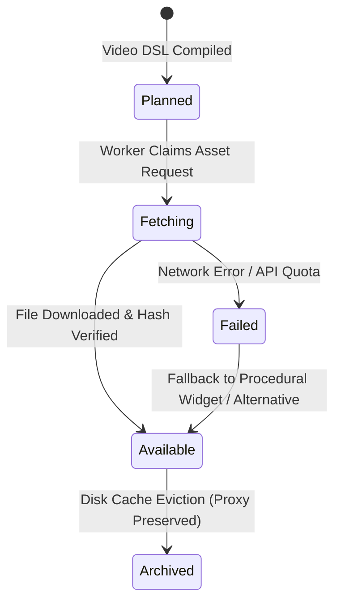

# 📦 ASSET REGISTRY SPECIFICATION (`ASSET_REGISTRY_SPEC.md`)

> **Document Version:** 2.0.0  
> **Target Schema:** `packages/core-schema/src/asset-registry.ts`  
> **Status:** Authoritative Specification  

---

## 1. PURPOSE & ARCHITECTURAL FOUNDATION

The **Asset Registry** provides unified, content-addressable storage, license tracking, and metadata caching for all media consumed and generated by Autonomous Studio Pro.

In an AI-driven editing workflow, assets are frequently generated dynamically (TTS audio, AI B-Roll, web article screenshots) or fetched from external stock APIs (Pexels, Unsplash, Pixabay). The Asset Registry ensures that:
1. Every asset has a stable, globally unique identifier and content SHA-256 hash.
2. Every asset tracks its license, author attribution, and commercial clearance status.
3. Media is deduplicated at the storage layer.
4. Fast 720p proxies and waveform pyramids are generated automatically for low-latency editing.

---

## 2. FORMAL ASSET DATA SCHEMA

```typescript
export type AssetKind = 
  | 'video' 
  | 'audio' 
  | 'image' 
  | 'article-screenshot' 
  | 'generated-ai' 
  | 'lut-3d' 
  | 'font'
  | 'pre-asset-placeholder';

export type AssetAvailabilityStatus = 
  | 'planned'      // Defined in Video DSL, media not yet acquired
  | 'fetching'     // Download or generation worker in progress
  | 'available'    // Present on local disk and verified
  | 'failed'       // Fetch failed, fallback active
  | 'archived';    // Offloaded from active SSD cache

export interface AssetLicenseRecord {
  readonly provider: 
    | 'local-disk' 
    | 'pexels' 
    | 'pixabay' 
    | 'unsplash' 
    | 'wikimedia' 
    | 'internet-archive' 
    | 'giphy' 
    | 'web-article-playwright'
    | 'ai-flux-imagen'
    | 'ai-tts-voice'
    | 'ai-mmaudio-sfx';
  readonly sourceUrl?: string;
  readonly authorName?: string;
  readonly licenseType: 'public-domain' | 'creative-commons-zero' | 'stock-royalty-free' | 'editorial-fair-use' | 'proprietary';
  readonly attributionRequired: boolean;
  readonly commercialUsePermitted: boolean;
}

export interface MediaAssetRecord {
  readonly id: string;                     // e.g. 'asset_sha256_e3b0c442...'
  readonly name: string;
  readonly kind: AssetKind;
  readonly status: AssetAvailabilityStatus;
  readonly sha256: string;                 // Hex content hash
  readonly byteSize: number;
  readonly localFilePath: string;          // Master source on SSD
  readonly proxyFilePath?: string;         // Fast 720p ProRes / WebCodecs proxy
  readonly thumbnailPath?: string;         // 320x180 preview frame
  readonly waveformJsonPath?: string;      // Precomputed audio peak array
  readonly duration?: RationalTime;
  readonly dimensions?: { readonly width: number; readonly height: number; readonly fps: number };
  readonly semanticTags: readonly string[];// Keywords for AI B-Roll matching
  readonly aestheticScore?: number;        // [0.0 .. 10.0] VLM Critic rating
  readonly license: AssetLicenseRecord;
  readonly createdAtIso: string;
}
```

---

## 3. ASSET LIFECYCLE: PRE-ASSETS & PLACEHOLDERS

To allow the Video DSL Compiler and script writers to construct complete scenes before footage is downloaded, the registry supports **Pre-Assets**:



1. **`Planned` (Pre-Asset):** Contains visual search query, target duration, and aspect ratio. Timeline shows a stylized animated wireframe box with search keywords.
2. **`Fetching`:** The `AssetHunterWorker` initiates download or neural generation in background. UI displays progress bar.
3. **`Available`:** File lands on disk, SHA-256 hash is verified, 720p proxy and audio waveform are generated. UI seamlessly swaps placeholder with live video stream.
4. **`Failed`:** If stock footage is unavailable, the fallback policy automatically substitutes a deterministic stage widget or procedural motion card without interrupting playback.

---

## 4. DEDUPLICATION & CONTENT-ADDRESSABLE STORAGE

- When a file is imported via the UI, CLI, or Web Hunter, its SHA-256 checksum is computed immediately.
- If an identical hash already exists in `project.mediaPool`, the registry returns the existing `assetId` instead of duplicating files on disk.
- Storage directory structure:
  ```
  .vproj/
    assets/
      masters/
        e3/
          e3b0c44298fc1c149afbf4c8996fb924...mp4
      proxies/
        e3b0c442_720p_proxy.mp4
      thumbnails/
        e3b0c442_thumb.webp
      waveforms/
        e3b0c442_peaks.json
  ```

---

## 5. LICENSE COMPLIANCE & EXPORT ATTRIBUTION TABLE

When exporting a final master video (`RenderSequence`), the Asset Registry automatically compiles an **Attribution & Provenance Manifest** (`credits.json` / `youtube_description.txt`):
- Lists all creator attributions required by Creative Commons or stock provider licenses.
- Flags any editorial / fair-use screenshots (e.g. financial news headlines) with appropriate fair-use disclaimers.
- Guarantees 100% compliance for YouTube monetization without copyright claims.

