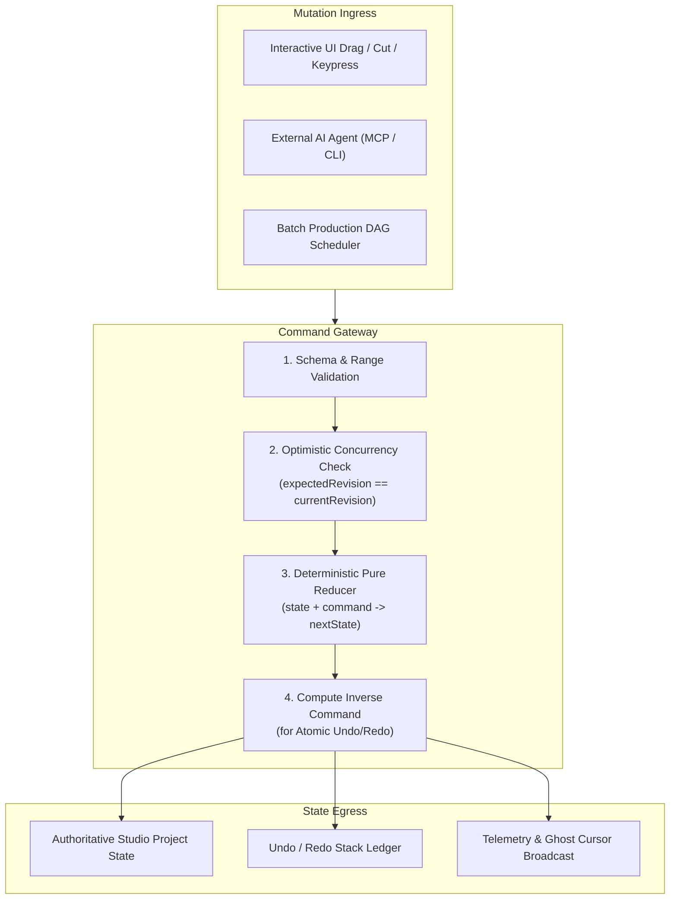

# 🛡️ COMMAND GATEWAY CONTRACTS (`COMMAND_CONTRACTS.md`)

> **Document Version:** 2.0.0  
> **Target Schema:** `packages/core-schema/src/command-gateway.ts`  
> **Status:** Authoritative Specification  

---

## 1. PURPOSE & ARCHITECTURAL ROLE

The **Command Gateway** is the single authoritative mutation ingress for the entire Autonomous Studio Pro system. No UI component, background worker, or external AI agent may mutate the project AST directly.

Every modification is encapsulated as a serialized **Command Envelope**, validated against formal schemas, checked for revision concurrency, recorded in the undo/redo ledger, and broadcast to listening telemetry services.



---

## 2. COMMAND ENVELOPE SPECIFICATION

Every command dispatched through the gateway is wrapped in an authoritative envelope:

```typescript
export interface CommandActor {
  readonly kind: 'user' | 'agent' | 'system';
  readonly id: string;           // e.g. 'user_main', 'agent_roughcut_01', 'agent_vscode_external'
  readonly role?: string;        // e.g. 'editor', 'director', 'colorist'
  readonly displayName: string;  // e.g. '🤖 VS Code / Antigravity Agent'
}

export interface CommandEnvelope<TCommand = TimelineCommand> {
  readonly commandId: string;
  readonly timestampMs: number;
  readonly actor: CommandActor;
  /** Expected project revision before mutation; enforces optimistic concurrency control */
  readonly expectedRevision?: number;
  /** Natural language reasoning provided by an AI Agent explaining the intent */
  readonly reasoning?: string;
  readonly command: TCommand;
}
```

---

## 3. THE 18 STANDARD TIMELINE COMMANDS

The Command Gateway defines 18 canonical commands covering all editing, compositing, and rendering operations:

| # | Command Type | Target | Description & Arguments |
| :-: | :--- | :--- | :--- |
| **1** | `ImportMedia` | Media Pool | Registers a new local or stock asset into `mediaPool`. <br>`{ asset: MediaAsset }` |
| **2** | `CreateSequence` | Project | Creates a new sequence with dedicated resolution and fps. <br>`{ sequenceId: string, name: string, settings: SequenceSettings }` |
| **3** | `AddTrack` | Sequence | Appends or inserts a new track of specified kind. <br>`{ sequenceId: string, track: TimelineTrack }` |
| **4** | `InsertClip` | Track | Inserts a clip at `startTime`. Supports optional subsequent ripple. <br>`{ trackId: string, clip: TimelineClip, rippleShift: boolean }` |
| **5** | `MoveClip` | Track / Time | Relocates a clip to a new start time and/or target track. <br>`{ clipId: string, newTrackId: string, newStartTime: RationalTime }` |
| **6** | `TrimClip` | Clip Boundaries | Adjusts clip start, duration, or source offset without moving other clips. <br>`{ clipId: string, newTimelineRange: TimeRange, newSourceRange: TimeRange }` |
| **7** | `SplitClip` | Clip | Slices a clip into two distinct clips at the specified split time. <br>`{ clipId: string, splitTime: RationalTime }` |
| **8** | `DeleteClip` | Track | Removes a clip; optionally closes the resulting gap. <br>`{ clipId: string, rippleShiftSubsequentClips: boolean }` |
| **9** | `ApplyTransition` | Clip Boundary | Attaches or updates a GLSL transition on clip in/out. <br>`{ clipId: string, boundary: 'in' \| 'out', transition: ClipTransition }` |
| **10** | `ApplyEffect` | Clip | Attaches a GPU shader effect instance to `clip.shaders`. <br>`{ clipId: string, effect: ShaderEffectInstance }` |
| **11** | `SetKeyframe` | Property | Inserts or updates an animated keyframe on an animatable curve. <br>`{ clipId: string, propertyPath: string, keyframe: Keyframe<any> }` |
| **12** | `UpdateCharacterPose` | Stage Puppet | Sets move-set, facial expression, and hand prop on a stage clip. <br>`{ clipId: string, moveSetId: string, expressionId: string, handProp?: string }` |
| **13** | `ApplyMotionPreset` | Motion Code | Assigns a procedural graphic template and text payload. <br>`{ clipId: string, templateId: string, props: Record<string, any> }` |
| **14** | `UpdateSceneComposition` | Stage Clip | Updates 2.5D camera rig, backdrop, widget, and particles. <br>`{ clipId: string, cameraRigId: string, backdropId: string, widget?: StageWidget }` |
| **15** | `AdjustAudio` | Clip Audio | Sets volume dB, auto-ducking role, pan, or denoise flags. <br>`{ clipId: string, audioConfig: Partial<AudioProcessingConfig> }` |
| **16** | `AdjustColor` | Clip Color | Modifies DaVinci color grading parameters (exposure, contrast, LUT, grain). <br>`{ clipId: string, colorGrade: Partial<ColorGradeConfig> }` |
| **17** | `ReplaceAsset` | Clip Source | Swaps underlying `assetId` while strictly preserving cuts and keyframes. <br>`{ clipId: string, newAssetId: string }` |
| **18** | `RenderSequence` | Export Engine | Submits a sequence render job to the background export worker. <br>`{ sequenceId: string, exportConfig: RenderExportConfig }` |

---

## 4. UNDO / REDO & ATOMIC INVERSIONS

Every successful command execution produces an **Inverse Command** calculated against the state immediately prior to mutation:

$$\text{execute}(S_t, C) \longrightarrow \left( S_{t+1}, C^{-1} \right)$$

### Canonical Inversion Rules:
- $\text{InsertClip}^{-1} \longrightarrow \text{DeleteClip}$ (specifying the newly created clip ID).
- $\text{DeleteClip}^{-1} \longrightarrow \text{InsertClip}$ (reinserting the exact prior clip definition and position).
- $\text{MoveClip}^{-1} \longrightarrow \text{MoveClip}$ (restoring prior track ID and start time).
- $\text{TrimClip}^{-1} \longrightarrow \text{TrimClip}$ (restoring prior timelineRange and sourceRange).
- $\text{SplitClip}^{-1} \longrightarrow$ Composite undo that merges the two split halves back into the original clip.

### Agent-Specific Undo (`undoAgent`):
The undo stack maintains the `actor.id` of every command. When a human clicks **Undo on a specific AI Agent** (e.g., reverting the Rough-Cut agent without wiping out the Colorist's edits), the gateway walks the ledger backward, inverting only commands authored by that agent while reconciling dependent clip IDs.

---

## 5. CONCURRENCY CONTROL & ERROR HANDLING

If a mutation fails validation or encounters a revision mismatch, the Command Gateway rejects the transaction atomically:

```typescript
export interface CommandResult {
  readonly success: boolean;
  readonly commandId: string;
  readonly newRevision: number;
  readonly rejectedReason?: string;
  readonly errorCode?: 'CONCURRENCY_CONFLICT' | 'SCHEMA_VALIDATION_ERROR' | 'TRACK_LOCKED' | 'NOT_FOUND';
}
```

### Optimistic Concurrency Protocol:
1. Agent queries timeline state at $\text{revision} = 42$.
2. Agent prepares `InsertClip` command with `expectedRevision: 42`.
3. If human user split a clip in the interim ($\text{revision}$ advanced to $43$), the gateway rejects the agent command with code `CONCURRENCY_CONFLICT`.
4. The agent queries the diff, updates its target coordinates, and resubmits with `expectedRevision: 43`.

