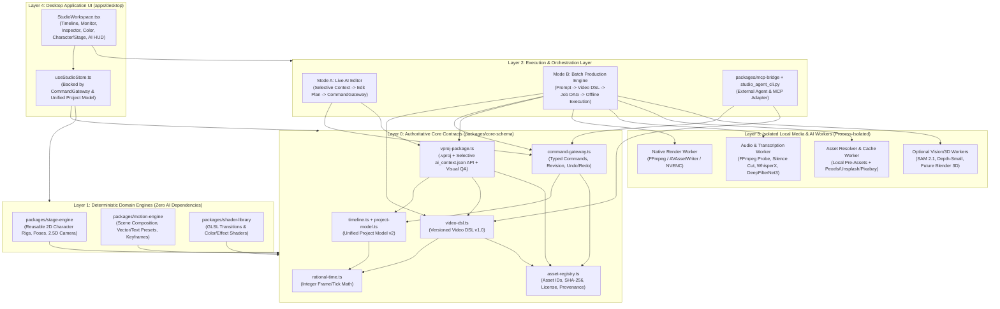

# 🕸️ PHASE 0: SYSTEM DEPENDENCY GRAPH & MODULE BOUNDARIES (`DEPENDENCY_GRAPH.md`)

> **Audit Date:** 2026-11-03  
> **Architectural Rule:** Strict unidirectional dependency flow. No circular dependencies. No external reference repository may redefine `packages/core-schema`.

---

## 1. TARGET LAYERED DEPENDENCY GRAPH

---

## 2. STRICT DEPENDENCY RULES ENFORCED

1. **`packages/core-schema` Has Zero External Runtime Dependencies**:
   - Pure TypeScript types, deterministic validators, integer `RationalTime` arithmetic, `CommandGateway` state machine, `VideoDSL` compiler, and `.vproj` selective context extractor (`ai_context.json`).
   - Can be imported by React UI, Node CLI tools, MCP servers, and test runners without pulling in DOM, WebGL, or AI SDKs.
2. **Domain Engines (`stage-engine`, `motion-engine`, `shader-library`) Depend Only on `core-schema`**:
   - They never call AI models or mutate the project store directly.
   - Given `(sceneSpec, frameTime)`, they are 100% deterministic pure functions.
3. **AI Agents & Workers Never Mutate State Directly**:
   - External AI (VS Code Agent, Claude, Gemini, Local LLM) and internal workers must either:
     - Emit a **Versioned `VideoDSL` Specification**, which the deterministic DSL Compiler translates into validated `CommandGateway` commands; OR
     - Submit typed **`CommandGateway` envelopes** (`expectedRevision`, `origin`, `command`) which are validated and applied atomically.
4. **Process Isolation for Heavy/Native Dependencies**:
   - `FFmpeg`, `WhisperX`, `DeepFilterNet3`, `SAM 2.1`, `Video-Depth-Anything-Small`, and future `Blender` run in isolated worker processes behind `WorkerTaskEnvelope` / `WorkerResultEnvelope` contracts. If any optional worker is not installed on the user's machine, the editor remains 100% functional.

