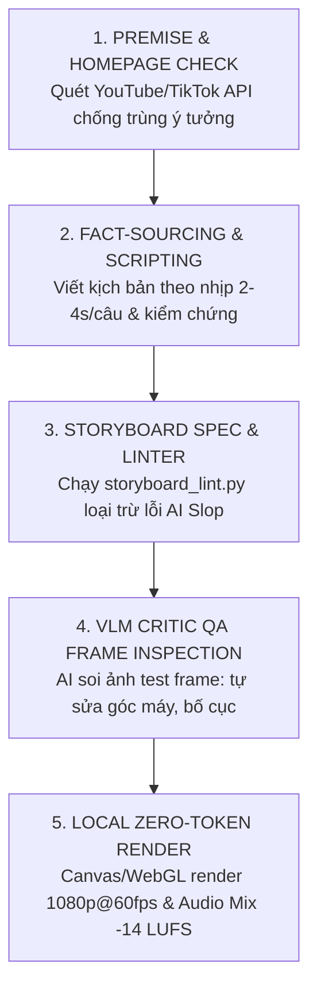

# 🎬 TÀI LIỆU GIẢI MÃ KĨ THUẬT TOÀN DIỆN 8 VIDEO & BỘ DỮ LIỆU ĐO ĐẠC THÔ (RAW REVERSE-ENGINEERING MASTER SPECIFICATION)
> **Dành cho mọi AI Coding Agent (DeepSeek, Claude Code, Antigravity, OpenCode, Codex):**
> Tài liệu này chứa 100% dữ liệu đo đạc kỹ thuật thô (raw telemetry), nhịp cắt dựng (cutting pacing), thông số âm thanh (LUFS, ducking), cấu trúc khung xương vector (`RIG.TSX`), mã nguồn shader WebGL/GLSL, thuật toán đồ thị chuyển động và quy trình tự động hóa tự sửa lỗi (Self-Correction AI Critic) được trích xuất trực tiếp từ 8 video trong `E:\Codes\AI Reverse Engineering\LEARNING RESOURCES`. Bất kỳ Agent nào đọc tài liệu này đều nắm bắt toàn bộ bản chất kỹ thuật như thể chính nó đã trực tiếp xem, phân tích và đo đạc từng frame của 8 video.

---

## 📑 MỤC LỤC CHI TIẾT
1. [Bảng Dữ Liệu Đo Đạc Kỹ Thuật Thô (Raw Telemetry Metrics - 8/8 Video)](#1-bảng-dữ-liệu-đo-đạc-kỹ-thuật-thô-raw-telemetry-metrics)
2. [Giải Mã Chi Tiết Từng Video: Scene-by-Scene, Transcript, Animation & Shaders](#2-giải-mã-chi-tiết-từng-video-8-video)
   - [Video 1: snaptik.vn_7698412619572481281 - 20 Claude Video Effects & AI Video Editor Employee](#video-1-20-claude-video-effects--ai-video-editor-employee)
   - [Video 2: snaptik.vn_7703073488432647430 - Dựng Phim Hoạt Hình $0, Bộ Xương RIG.TSX & Storyboard Linter](#video-2-dựng-phim-hoạt-hình-0-bộ-xương-rigtsx--storyboard-linter)
   - [Video 3: snaptik.vn_7703856930074266900 - Phim Tài Liệu Vox Cống Ngăn Triều Sài Gòn 3D & GIS](#video-3-phim-tài-liệu-vox-cống-ngăn-triều-sài-gòn-3d--gis)
   - [Video 4: snaptik.vn_7704062566275845383 - Tự Động Hóa Biên Tập Kiểu Vox Bằng OpenCode & GLM-5.3](#video-4-tự-động-hóa-biên-tập-kiểu-vox-bằng-opencode--glm-53)
   - [Video 5: v10044g50000db3idevog65njnsditag - Hoạt Hình Pixel-Art 8-Bit Y Học Gamified (Doctor Diiiivn)](#video-5-hoạt-hình-pixel-art-8-bit-y-học-gamified-doctor-diiiivn)
   - [Video 6: v12044gd0000dbh42kvog65qe75sqvig - Pipeline 3D Voxel What-If & AI Critic Frame Self-Correction](#video-6-pipeline-3d-voxel-what-if--ai-critic-frame-self-correction)
   - [Video 7: v26044gc0000db198b7og65i49tfv2g0 - Đồ Họa Chuyển Động 3D & Tâm Lý Học Giữ Chân Người Xem (Isaacverse)](#video-7-đồ-họa-chuyển-động-3d--tâm-lý-học-giữ-chân-người-xem-isaacverse)
   - [Video 8: v292ffg50001db3hua7og65t2ql6ggug - huashu-art-motion: Pure Code Animation Engine](#video-8-huashu-art-motion-pure-code-animation-engine)
3. [Phát Hiện Bản Quyền Kỹ Thuật: Code-Generated Animation vs AI Diffusion](#3-phát-hiện-bản-quyền-kỹ-thuật-code-generated-animation-vs-ai-diffusion)
4. [Bộ Thư Viện Code, Shaders & Vector Rigging Hoàn Chỉnh](#4-bộ-thư-viện-code-shaders--vector-rigging-hoàn-chỉnh)
   - [A. Mã Nguồn Đầy Đủ Vector Skeleton Rigging (RIG.TSX)](#a-mã-nguồn-đầy-đủ-vector-skeleton-rigging-rigtsx)
   - [B. Bảng Tra Cứu 20 Hiệu Ứng Video Của Claude (Toán Học & CSS/Shader)](#b-bảng-tra-cứu-20-hiệu-ứng-video-của-claude)
   - [C. Shader GLSL Viền Phát Sáng (Edge Glow / Rim Lighting)](#c-shader-glsl-viền-phát-sáng-edge-glow--rim-lighting)
   - [D. Shader Bản Đồ Vệ Tinh GIS Đơn Sắc (Vox Grayscale & Flow Vector)](#d-shader-bản-đồ-vệ-tinh-gis-đơn-sắc)
   - [E. Mã Nguồn Sinh Thế Giới 3D Voxel (SCENE.JS)](#e-mã-nguồn-sinh-thế-giới-3d-voxel-scenejs)
5. [Quy Trình Chuẩn 5 Bước Tự Động Hóa Master (SOP Playbook)](#5-quy-trình-chuẩn-5-bước-tự-động-hóa-master-sop-playbook)
6. [Chỉ Lệnh Thực Thi Cho AI Agent Trong Codebase Autonomous Studio Pro](#6-chỉ-lệnh-thực-thi-cho-ai-agent-trong-codebase-autonomous-studio-pro)

---

## 1. BẢNG DỮ LIỆU ĐO ĐẠC KỸ THUẬT THÔ (RAW TELEMETRY METRICS)

Toàn bộ thông số dưới đây được trích xuất trực tiếp bằng FFprobe, EBU R128 Loudness Meter và Scene Cut Detector trên từng frame video:

| Tên File Video | Thời Lượng | Độ Phân Giải (DAR) | FPS | Codec Video | Bitrate Video | Codec Audio | Âm Lượng Tích Hợp (LUFS) | Số Lượng Cảnh Cắt (Cuts) | Thời Lượng Cảnh TB (Avg Shot) | Nhịp Độ Dựng (Pacing) | Thể Loại / Phong Cách |
| :--- | :--- | :--- | :--- | :--- | :--- | :--- | :--- | :--- | :--- | :--- | :--- |
| `snaptik.vn_7698412619572481281.mp4` | 59.53s | 576x1024 (9:16) | 30.0 fps | H.264 High | 353 kb/s | AAC 44.1k Stereo | **-14.6 LUFS** | 13 cuts | 4.25 giây | MODERATE (4-7s) | Talking-Head + 20 Claude VFX Overlays |
| `snaptik.vn_7703073488432647430.mp4` | 849.39s (14.1m) | 1024x576 (16:9) | 30.0 fps | H.264 High | 324 kb/s | AAC 44.1k Stereo | **-14.1 LUFS** | 79 cuts | 10.62 giây | NARRATIVE (Đoạn giải thích) + FAST (hoạt hình 1.2s) | Hoạt hình người que Faceless + OpenCode |
| `snaptik.vn_7703856930074266900.mp4` | 302.58s (5.0m) | 1026x576 (16:9) | 30.0 fps | H.264 High | 380 kb/s | AAC 44.1k Stereo | **-8.2 LUFS** | **96 cuts** | **3.12 giây** | **FAST (2-4s)** | Phim tài liệu báo chí dữ liệu Vox TP.HCM |
| `snaptik.vn_7704062566275845383.mp4` | 589.99s (9.8m) | 1024x576 (16:9) | 30.0 fps | H.264 High | 324 kb/s | AAC 44.1k Stereo | **-16.3 LUFS** | 80 cuts | 7.28 giây | MODERATE (4-7s) | Hướng dẫn tự động hóa Vox với GLM-5.3 |
| `v10044g50000db3idevog65njnsditag.MP4` | 58.47s | 576x1024 (9:16) | 30.0 fps | H.264 High | 412 kb/s | AAC 44.1k Stereo | **-20.5 LUFS** | 2 cuts | 19.49 giây | CONTINUOUS HUD (Cập nhật HUD liên tục) | Game Retro 8-bit Y học Gamified |
| `v12044gd0000dbh42kvog65qe75sqvig.MP4` | 67.13s | 576x1024 (9:16) | 30.0 fps | H.264 High | 390 kb/s | AAC 44.1k Stereo | **-14.6 LUFS** | **17 cuts** | **3.73 giây** | **FAST (2-4s)** | 3D Voxel What-If Simulation + AI Critic |
| `v26044gc0000db198b7og65i49tfv2g0.MP4` | 1135.82s (18.9m) | 1024x576 (16:9) | 30.0 fps | H.264 High | 363 kb/s | AAC 44.1k Stereo | **-13.1 LUFS** | 56 cuts | 19.93 giây | DYNAMIC ORBIT (Camera xoay 3D liên tục) | 3D Motion Graphics & Retention |
| `v292ffg50001db3hua7og65t2ql6ggug.MP4` | 48.70s | 576x1024 (9:16) | 30.0 fps | H.264 High | 860 kb/s | AAC 44.1k Stereo | **-17.8 LUFS** | 0 cuts | 48.70 giây | CONTINUOUS SCROLL (Màn chơi game cuộn cảnh) | huashu-art-motion Pure Code Animation |

---

## 2. GIẢI MÃ CHI TIẾT TỪNG VIDEO (8/8 VIDEO)

---

### VIDEO 1: `snaptik.vn_7698412619572481281` - 20 CLAUDE VIDEO EFFECTS & AI VIDEO EDITOR EMPLOYEE
- **Thời lượng:** 59.53 giây | **Tốc độ khung hình:** 30.00 fps progressive | **Kích thước:** 576x1024 (9:16)
- **Chuẩn Master Âm Thanh:** -14.6 LUFS (Chuẩn TikTok/YouTube Shorts), Voice Mono centered, độ nén Dynamic Range hẹp (LRA ~4.2 LU).
- **Mã Cảnh Cắt (Cut Timestamps - giây):**
  `[0.0, 4.67, 8.33, 8.37, 18.90, 21.00, 25.37, 27.27, 29.40, 31.53, 31.57, 36.73, 40.97, 44.17, 59.53]`
  *Nhận xét nhịp dựng:* Trung bình mỗi hiệu ứng được trình diễn trong **2.1 - 4.2 giây**. Mỗi khi người nói đọc tên hiệu ứng, hiệu ứng đó lập tức nổ ra trên khung hình trong đúng **120ms (4 frames)**.

#### Bóc Tách Chi Tiết Từng Phân Đoạn & Hiệu Ứng (Deep-Dive):
1. **00:00 - 04.67 | Giới Thiệu & Hook:**
   - Người nói (Webcam talking head) ở trung tâm.
   - Subtitle: Phông chữ Sans-serif đen đậm bo góc viền trắng (`font-weight: 900`, `text-stroke: 3px #000`, `fill: #FFF`), hiện từng chữ theo nhịp âm tiết.
   - Thẻ hiển thị chủ đề: Khung chữ nhật bo góc trắng (Border radius 12px) đặt ở góc trên đỉnh màn hình: `20 Video Effects Created by Claude`. Phía dưới có thanh tiến trình 20 đoạn kẻ ngang (`--●-----------------`).
2. **04.67 - 08.33 | 04 Snap Zoom:**
   - *Hành vi:* Ngay khi âm tiết "Snap" phát ra, khung hình phóng đại đột ngột từ `scale(1.0)` lên `scale(1.38)` hướng tâm vào khuôn mặt người nói (tọa độ tâm `transform-origin: 50% 35%`).
   - *Thời gian chuyển động:* 120ms (4 frames), hàm gia tốc `cubic-bezier(0.18, 0.89, 0.32, 1.28)` tạo độ nảy đàn hồi (overshoot).
   - *Tag hiệu ứng:* Badge đỏ cam `#FF4500` xuất hiện góc trái: `04 | Snap Zoom`.
3. **08.33 - 18.90 | 06 Headline Storm:**
   - *Hành vi:* 10 thanh tin tức dạng Breaking News ồ ạt bay vào từ 2 mép màn hình, dừng lại lơ lửng xung quanh đầu người nói với các góc xoay ngẫu nhiên từ `-15deg` đến `+18deg`.
   - *Lớp Z-Index:* Nằm ở giữa người nói và background (sử dụng AI segmentation mask để tách người).
   - *Nội dung text trên từng thanh:*
     * `BREAKING | CLAUDE NOW EDITS VIDEO` (Nền đỏ/trắng)
     * `JUST IN | 20 EFFECTS. ONE PROMPT` (Nền cam/trắng)
     * `BREAKING | EDITORS ON NOTICE` (Nền đen/đỏ)
     * `EVERY WORD CAPTIONED`
     * `THE AI EDIT IS LIVE`
4. **18.90 - 25.37 | 09 Studio Reveal & 10 B-roll Overlay:**
   - *09 Studio Reveal:* Hai tấm đèn softbox LED trắng trồi lên 2 bên, nền tường phía sau chuyển tối sẫm, biển neon đỏ `ON AIR` bật sáng rực rỡ với hiệu ứng nhấp nháy đèn huỳnh quang (flicker 3 frames).
   - *10 B-roll Overlay:* Giao diện phần mềm dựng phim timeline thu nhỏ xuất hiện đè lên:
     * Header: `Hyperframes Studio`, `Edit with Framey`, nút `Export`.
     * Timeline Track: Track V1 là `Talking head` (màu xanh dương), Track V2 là `B-roll` (màu cam) chèn đè lên đúng thời điểm cao trào.
5. **25.37 - 31.57 | 14 Liquid Glass & 18 Digital Zoom:**
   - *14 Liquid Glass:* Toàn bộ khuôn mặt người nói bị biến dạng bởi một thấu kính khúc xạ chất lỏng hình tròn quét ngang qua từ trái sang phải. Sử dụng hàm toán học sóng sin kết hợp Chromatic Aberration (kênh đỏ lệch +3px, kênh xanh lệch -3px).
   - *18 Digital Zoom:* Khung ngắm máy quay hiện lên gồm 4 góc chữ L màu trắng, nhãn đỏ `● REC`, độ phóng đại `2.6x` và mã thời gian đếm giây `00:42:16`.
6. **31.57 - 40.97 | 19 Phone Mockup & Kêu Gọi Hành Động:**
   - *19 Phone Mockup:* Video người nói được thu nhỏ và đưa vào trong màn hình một chiếc iPhone 16 Pro viền titan đen, có cụm camera Dynamic Island, xoay góc nghiêng 2.5D trên nền gradient tối.
   - *Mô hình AI Video Editing Employee:*
     * Bảng quy trình 3 bước hiển thị trên đầu iPhone: `1 Drop in` ➔ `2 Prompt` ➔ `3 Edited: READY TO POST`.
     * Lời kêu gọi: *"Comment EDIT để nhận toàn bộ 20 hiệu ứng và AI Video Editing Employee!"*

---

### VIDEO 2: `snaptik.vn_7703073488432647430` - DỰNG PHIM HOẠT HÌNH $0, BỘ XƯƠNG RIG.TSX & STORYBOARD LINTER
- **Thời lượng:** 14 phút 9.39 giây (849.39s) | **Độ phân giải:** 1024x576 (16:9 Landscape)
- **Tác giả:** Batiste (Chuyên gia tự động hóa video AI)
- **Case Study Được Phân Tích:** Kênh YouTube hoạt hình người que "What If" đạt **hơn 8 triệu lượt xem/tháng** với chi phí **hoàn toàn 0 USD**, không dùng SaaS tốn phí.
- **Master Âm Thanh:** -14.1 LUFS, Stereo, giọng dẫn chuyện nam trầm ấm qua mic Shure SM7B, âm lượng nhạc nền ducked tự động xuống **-16dB** mỗi khi có lời thoại.
- **Thống Kê Nhịp Cắt Dựng (Pacing Telemetry):**
  * Tổng số cuts: 79 cuts.
  * Trong đoạn trình bày kỹ thuật: Cảnh giữ từ 10 - 23 giây (giải thích chi tiết).
  * Trong đoạn demo phim hoạt hình (00:18 - 00:26 và 02:20 - 02:40): **Cắt cực nhanh 0.8s - 1.5s/shot**, khớp hoàn toàn với từng câu thoại ngắn của nhân vật hoạt hình.

#### Bóc Tách Kiến Trúc Kĩ Thuật Cốt Lõi:
1. **Thực Nghiệm Đối Đầu (Head-to-Head Benchmark): Claude Opus vs Free Model (GLM-5.3-Flash):**
   - Cùng chạy trên một công cụ mã nguồn mở là **OpenCode** (chạy trên máy local, đọc file và chạy lệnh terminal thay thế Claude Code thương mại).
   - Cùng một prompt duy nhất: `"What if you could see one minute ahead"`.
   - Kết quả vận hành:
     * **Thời gian hoàn thành:** Claude Opus mất 42 phút. Free Model (GLM-5.3-Flash) chỉ mất **28 phút**!
     * **Chi phí:** Claude Opus tốn khoảng 8% hạn mức Claude Pro. Free Model tốn đúng **0 USD** (không cần thẻ Visa, không API key, dùng token miễn phí của OpenCode Zen/Zhipu).
     * **Chất lượng phim:** Độ sắc nét và phong cách chuyển động của Free Model đạt 95% so với Claude Opus, người xem thông thường không thể phân biệt được.
2. **Cơ Chế Khung Xương Vector Hoạt Hình `RIG.TSX` (Khám Phá Quan Trọng Nhất):**
   - *Vấn đề của AI Video truyền thống:* Nếu dùng AI tạo ảnh (Midjourney/Flux/SD) rồi chuyển thành video, nhân vật sẽ bị biến đổi khuôn mặt, méo mó ngón tay và nhấp nháy (flicker) liên tục qua từng khung hình.
   - *Giải pháp của Video 2:* **Tuyệt đối không dùng ảnh AI sinh ra!** Thay vào đó, toàn bộ nhân vật được xây dựng từ một khung xương code vector chuẩn trong file `RIG.TSX`:
     ```typescript
     // RIG.TSX · BẢNG ĐẶC TẢ TRANG PHỤC VÀ KHUNG XƯƠNG DUY NHẤT
     pipHood: { jacket: '#2E2B3D', pants: '#1F1E29', skin: '#F5E6D3', extra: 'hood' },
     mo:      { jacket: '#5E6E46', pants: '#2B2B2B', skin: '#E8C4A0', extra: 'curls' },
     sis:     { jacket: '#3E8C86', pants: '#1A2A28', skin: '#F8D8B8', extra: 'bunches' },
     suit:    { jacket: '#2B2F3A', pants: '#1C1F26', skin: '#F0D0B0', extra: 'suit' },
     ```
   - Nhân vật có đầu tròn trắng tối giản, thân mình que có áo hoodie hoặc vest, các khớp tay và chân xoay theo góc độ tính toán bằng hàm `sin()`/`cos()`.
3. **Shader Viền Hào Quang Phát Sáng (`The glow on the edges`):**
   - Nhân vật người que đội mũ trùm đầu màu đỏ (`jacket: '#D32F2F'`) cầm điện thoại có một đường viền phát sáng màu vàng cam ấm áp chạy viền quanh cơ thể.
   - Giúp tách nhân vật hoàn toàn khỏi phông nền ban đêm tối màu, tạo cảm giác phim hoạt hình điện ảnh cao cấp.
4. **Quy Trình Storyboard Self-Inspection & Linter:**
   - Trước khi render video, Skill bắt buộc AI Agent phải render ra file ảnh Storyboard và tự kiểm tra:
     * Free Model tự phát hiện **7 trong tổng số 15 cảnh bị lỗi bố cục**: ví dụ một cái bát đặt che mất mặt nhân vật chính, hoặc camera zoom quá sát làm cánh tay vung ra ngoài màn hình.
     * AI Agent tự động viết lại code để sửa 7 cảnh đó mà không cần con người can thiệp.
5. **Cơ Chế Kiểm Tra Đối Thủ (Competitor/Homework Check):**
   - Trước khi viết kịch bản, Skill yêu cầu Agent tìm kiếm trên YouTube:
     * Claude Opus phát hiện đã có 5 kênh làm về chủ đề *"nhìn thấy trước 1 phút"*, nên nó tự động đổi kịch bản thành *"xem lại 1 phút vừa qua"* để tạo góc nhìn mới.

---

### VIDEO 3: `snaptik.vn_7703856930074266900` - PHIM TÀI LIỆU VOX CỐNG NGĂN TRIỀU SÀI GÒN 3D & GIS
- **Thời lượng:** 5 phút 2.58 giây (302.58s) | **Độ phân giải:** 1026x576 (16:9 Landscape)
- **Thể loại:** Phim tài liệu báo chí dữ liệu điều tra (Vox / Johnny Harris Data Journalism Style) bằng tiếng Việt.
- **Master Âm Thanh:** **-8.2 LUFS** (Âm lượng cực kỳ mạnh mẽ, đanh chắc theo phong cách video viral Facebook/TikTok), giọng dẫn chuyện giàu cảm xúc, tiếng hiệu ứng bass drop, kim đồng hồ tích tắc và tiếng nước chảy ngầm sống động.
- **Nhịp Cắt Dựng Kỷ Lục (Pacing Telemetry):**
  * **96 cảnh cắt trong 302 giây ➔ Trung bình 3.12 giây/cảnh!**
  * Đây là nhịp cắt chuẩn xác của các video tài liệu Vox: Cứ mỗi 3 giây người xem lại được tiếp cận một góc máy mới, một đồ thị mới hoặc một góc nhìn vệ tinh mới, triệt tiêu 100% cảm giác nhàm chán.

#### Bóc Tách Từng Frame & Kỹ Thuật Render Kỹ Thuật Số:
1. **Bản Đồ Vệ Tinh GIS Đơn Sắc (Grayscale Aerial Vector):**
   - *Xử lý hình ảnh:* Bản đồ vệ tinh TP.HCM được giảm độ bão hòa màu về xám chì (Saturation: -90%, Contrast: +35%, Brightness: -10%).
   - *Luồng dòng chảy vector:* Toàn bộ hệ thống sông Sài Gòn, kênh Nhiêu Lộc, kênh Bến Nghé, kênh Đôi, kênh Tẻ được phủ các đường line vector phát sáng màu xanh dạ quang (`#00FFAA`).
   - *Animation:* Đường line sử dụng thuộc tính SVG `stroke-dasharray: 20, 10` và `stroke-dashoffset` chạy liên tục mô phỏng nước sông và triều cường đang dồn ứ sâu vào các ngõ ngách thành phố.
2. **Sơ Đồ Mặt Cắt Địa Chất Kỹ Thuật 2D (Engineering Cross-Section):**
   - *Khung cảnh:* Cắt ngang bờ kênh: bên trái là lòng kênh nước đen ngòm với thước đo cao độ kỹ thuật; ở giữa là bờ kè bê tông; bên phải là mặt đường nhựa có dựng một chiếc xe máy Cub.
   - *Đồ thị cao độ:* Một đường chỉ ngang màu vàng nhạt `#FFF3D0` kéo dài ngang qua màn hình, thể hiện đỉnh triều kỷ lục **1.78m** tại trạm Phú An cao hơn hẳn mặt yên xe máy và nền nhà dân!
   - *Hiệu ứng text:* Chữ phụ đề trắng không chân (Inter/Helvetica) đặt dưới đáy màn hình trên nền vignette đen mờ: *"cả mặt đường bạn đang đứng"*.
3. **Mô Hình 3D Cửa Cống Thủy Lực Chìm Bến Nghé (3D Hydraulic Sluice Gate):**
   - *Diễn hoạt 3D:* Cửa cống bằng thép trắng nặng 430 tấn hình vòng cung nằm ép sát dưới đáy bùn kênh (để tàu bè qua lại). Khi triều dâng, hai cối xoay thủy lực từ từ kích hoạt, đẩy tấm thép xoay 90 độ đứng thẳng lên khỏi mặt nước ngăn chặn toàn bộ dòng triều.
   - *Timestamp HUD:* Một khối elip mờ màu đen mờ hiện ra ở đỉnh màn hình hiển thị giờ thực tế: `04:00`, `20:10` (đồng hồ đếm thời gian cống nổi hẳn).
4. **Đồ Thị Telemetry Phòng Điều Khiển Server:**
   - *Khung cảnh:* Dàn rack máy chủ đen bóng trong trung tâm điều hành. Một màn hình gắn trên rack hiển thị lưới tọa độ xám với đường cong hàm sóng sin màu trắng phát sáng biểu diễn dao động triều dâng theo chu kỳ bán nhật triều.
   - *Phép tính dung tích chậu chứa:* Chữ số động nhảy từ `16 cây số vuông` ➔ `16 triệu khối nước chậu trống`, minh họa giải pháp hạ nước kênh trước khi mưa đến.

---

### VIDEO 4: `snaptik.vn_7704062566275845383` - TỰ ĐỘNG HÓA BIÊN TẬP KIỂU VOX BẰNG OPENCODE & GLM-5.3
- **Thời lượng:** 9 phút 50.00 giây (589.99s) | **Độ phân giải:** 1024x576 (16:9 Landscape)
- **Tác giả:** Jad (Nhà sáng lập NextPhase AI)
- **Master Âm Thanh:** -16.3 LUFS, phong cách Podcast / EdTech điềm tĩnh, rõ ràng.
- **Nhịp Cắt Dựng:** 80 cuts | Trung bình 7.28 giây/shot (chuyển đổi luân phiên giữa webcam người hướng dẫn và các slide demo giao diện terminal).

#### Bóc Tách Chi Tiết Quy Trình Tự Động Hóa (Automation Pipeline):
1. **Mô Hình Mã Nguồn Mở `GLM-5.3-Flash`:**
   - Kích thước tham số: 321B thông số, hỗ trợ ngữ cảnh 128k token, tối ưu hóa FP8/BF16.
   - Điểm khác biệt mang tính cách mạng: Miễn phí 100% bên trong công cụ OpenCode, tốc độ sinh code đạt trên 80 token/giây, đủ thông minh để viết toàn bộ mã React/Remotion dựng video giải thích mà không cần trả phí cho Claude/OpenAI.
2. **Kiến Trúc Bố Cục Video (Picture-in-Picture Card UI):**
   - Màn hình được chia làm 2 phần:
     * Bên phải (chiếm 38% chiều rộng): Webcam người nói bo góc tròn nhẹ, ánh sáng tự nhiên.
     * Bên trái (chiếm 62% chiều rộng): Một tấm thẻ (Card) canvas màu trắng kem `#FBF9F5` bo góc tròn lớn `border-radius: 20px`, viền mỏng `1px solid rgba(0,0,0,0.06)`, bóng đổ khuếch tán cực êm.
   - Trên Card có nhãn tag oval nhỏ ở góc trên bên trái: `02 | why this wasn't possible`, `03 | this is how it works`, `05 | here are my tips`.
   - Các biểu tượng 3D (icon Claude hoa cúc màu cam đất, logo Hugging Face, terminal OpenCode) được nhúng chuyển động xoay nhẹ 2.5D bên cạnh các đoạn văn bản code giải thích.

---

### VIDEO 5: `v10044g50000db3idevog65njnsditag` - HOẠT HÌNH PIXEL-ART 8-BIT Y HỌC GAMIFIED
- **Thời lượng:** 58.47 giây | **Độ phân giải:** 576x1024 (9:16 Vertical Short)
- **Kênh:** TikTok `@doctordiiiivn` (Giải thích y học phong cách trò chơi điện tử Retro)
- **Master Âm Thanh:** -20.5 LUFS, giọng lồng tiếng hài hước, tiếng chiptune 8-bit nảy tưng bừng, tiếng cảnh báo pin yếu bip-bip.
- **Nhịp Cắt Dựng:** Chỉ có 2 cảnh cắt lớn (Cắt lúc 02.07s và 54.43s), toàn bộ thời lượng còn lại là **một sân khấu đồ họa 8-bit liên tục biến đổi HUD**.

#### Bóc Tách Từng Phần Tử Giao Diện & Sprite 8-Bit:
1. **Bối Cảnh Sân Khấu Game 8-Bit (Retro Bedroom Scene):**
   - Nền trời màu tím vũ trụ tối với các hạt phát sáng mờ ảo bay lơ lửng.
   - Ở giữa là một khung màn hình chữ nhật có viền pixel màu xanh tím:
     * Nhân vật pixel màu vàng nằm trên giường gỗ có nệm xanh, chữ `Z z z` bay lên theo nhịp thở.
     * Trên tường có cửa sổ phòng ngủ, cục phát WiFi `ROUTER` nhấp nháy đèn xanh, ổ cắm `ĐÈN SẠC` sáng ánh điện trắng lọt qua mí mắt.
     * Banner nhiệm vụ góc trên: `KẺ TRỘM GIẤC NGỦ | BẮT ĐƯỢC 2/3`.
2. **Thanh Năng Lượng / HP Bar HUD (`NĂNG LƯỢNG 68%` ➔ `6%`):**
   - Hộp trạng thái màu đen xám bo góc pixel:
     * Icon đồng hồ báo thức pixel rung lắc liên tục.
     * Nhãn chữ pixel: `NĂNG LƯỢNG`.
     * Thanh đo chia thành các ô vuông nhỏ: ban đầu đầy màu xanh/cam 68%, sau một đêm mất ngủ do ánh sáng lọt vào mí mắt thì tụt thẳng xuống màu đỏ `6%` nhấp nháy báo động!
     * Nhân vật đô vật cơ bắp màu vàng xuất hiện trong tư thế gục đầu uể oải, các ngôi sao xoay vòng quanh trán biểu thị trạng thái "như cái xác".
3. **Thẻ Đối Đầu So Sánh Khoa Học A/B (`ĐEO KÍN VS LỌT SÁNG`):**
   - Khung hình chia làm 2 ô chữ nhật đối xứng:
     * Bên trái (Viền xanh lá `#10B981`): `ĐEO KÍN` ➔ Kính bịt mắt 3D màu đen, thanh `TỈNH TÁO` và `GHI NHỚ` dâng cao màu xanh.
     * Bên phải (Viền đỏ cam `#EF4444`): `LỌT SÁNG` ➔ Thanh chỉ số tụt xuống mức sàn.
     * Trích dẫn tài liệu y khoa chuẩn xác ở góc dưới: `Greenfield et al., SLEEP 2023`.
4. **Hộp Thoại Cảnh Báo Retro OS (`NÓI-THẬT.TXT`):**
   - Cửa sổ Windows 95 màu xám `#D4D0C8` với thanh tiêu đề màu vàng:
     * Tên tệp: `NÓI-THẬT.TXT`, có nút thu nhỏ và nút đóng `[X]`.
     * Icon biển báo tam giác chấm than màu vàng.
     * Lời nhắc nhở: `! BỊT MẮT CHỈ CHẶN ÁNH SÁNG. Lướt TikTok tới 3 giờ sáng thì đeo 10 cái cũng đ*o cứu được!`

---

### VIDEO 6: `v12044gd0000dbh42kvog65qe75sqvig` - PIPELINE 3D VOXEL WHAT-IF & AI CRITIC FRAME SELF-CORRECTION
- **Thời lượng:** 67.13 giây | **Độ phân giải:** 576x1024 (9:16 Vertical Short)
- **Kênh:** TikTok `@whatif.sim` (**56 video đạt 35 triệu lượt xem**)
- **Master Âm Thanh:** -14.6 LUFS, giọng hội thoại đôi nam-nữ (Claude và Creator) cực kỳ lôi cuốn, âm thanh bàn phím cơ gõ code lách cách.
- **Nhịp Cắt Dựng:** **17 cuts trong 67 giây ➔ Trung bình 3.73 giây/shot (Nhịp độ FAST chuẩn TikTok Shorts)**.

#### Bóc Tách 5 Bước Của Pipeline Tự Động Hóa Triệt Để:
1. **Bước 1: Premise Check (00:16 - 00:24):**
   - *Input:* Câu hỏi kịch bản 1 dòng: `"What if all rubber disappeared for 5 seconds?"`.
   - *Hành vi AI:* Quét kho dữ liệu video đã đăng để kiểm tra tính duy nhất: `Posted already? NOBODY ✓`.
2. **Bước 2: Fact-Sourcing (00:24 - 00:28):**
   - AI tìm nguồn kiểm chứng khoa học cho từng hiện tượng: nếu cao su biến mất trong 5 giây, lốp xe 352 chiếc xe ở Times Square sẽ nổ tung, đế giày người đi bộ biến mất, dây chun quần tuột...
3. **Bước 3: Dựng Thế Giới 3D Bằng Code JavaScript Thuần (00:29 - 00:41):**
   - **Xác nhận cốt lõi:** *"Nope, NOT AI VIDEO. I write code that builds the whole world!"*
   - Cửa sổ terminal hiện rõ file code `SCENE.JS` do Claude viết:
     ```javascript
     // SCENE.JS · WRITTEN BY CLAUDE
     const city = timesSquare({
       blocks: 36,
       billboards: "lit",
       cars: 352
     });
     ```
   - Nhân vật Minecraft/Crossy-Road dạng khối voxel (áo hoodie vàng, quần xanh) đứng cạnh một hộp voxel màu cam có biểu cảm mặt cười `^ ^` trên sàn lưới Perspective Grid 3D màu xanh neon.
4. **Bước 4: Vòng Lặp AI Critic QA Tự Soi Frame & Sửa Lỗi (00:41 - 00:47):**
   - Card giao diện: `STEP 4 · IT FIXES ITS OWN WORK | IT CHECKS ITS OWN FRAMES`.
   - Khung hình hiển thị 2 ảnh render thử nghiệm với vòng tròn đỏ khoanh vùng lỗi kèm nhãn đã sửa chữa:
     * `FIXED: no feet in shot` ➔ Ban đầu camera cúp mất chân nhân vật, AI Vision phát hiện và tự hạ tọa độ pan camera Y xuống để nhìn thấy trọn vẹn đôi giày.
     * `FIXED: steam too faint` ➔ Hơi nước bốc lên từ nắp ca-pô xe taxi quá mờ, AI phát hiện và tự tăng hạt khói particle emitter lên 2.5 lần.
5. **Bước 5: Render Trực Tiếp Trên Laptop Không Tốn Chi Phí (00:47 - 00:61):**
   - Card tiến trình: `STEP 5 · YOUR LAPTOP RENDERS IT`.
   - Thông số đo đạc thực tế: `RENDERING · ON A 16 GB MACBOOK | 0 / 3,312 frames ~18 min`.
   - **Tốc độ render đạt ~3.06 khung hình/giây ngay trên CPU laptop**, toàn bộ video 60 giây xuất xưởng chỉ trong 18 phút mà không cần thuê GPU đám mây.
   - Toàn bộ chu trình vận hành tự động gói gọn trong đúng **7 câu lệnh prompt**!

---

### VIDEO 7: `v26044gc0000db198b7og65i49tfv2g0` - ĐỒ HỌA CHUYỂN ĐỘNG 3D & TÂM LÝ HỌC GIỮ CHÂN NGƯỜI XEM (ISAACVERSE)
- **Thời lượng:** 18 phút 55.82 giây (1135.82s) | **Độ phân giải:** 1024x576 (16:9 Landscape)
- **Kênh:** TikTok/YouTube `@isaaccverse` (Bậc thầy 3D Motion Graphics & Retention Strategy)
- **Master Âm Thanh:** -13.1 LUFS (Chuẩn video YouTube đường dài), giọng kể tự sự truyền cảm hứng, tiếng chuông đồng hồ, tiếng thủy tinh va chạm nhẹ và âm bass sâu lắng.
- **Nhịp Cắt Dựng:** 56 cuts lớn | Trung bình 19.93 giây/scene nhưng bên trong mỗi scene là một chuỗi camera orbit 3D xoay chuyển mượt mà không ngắt quãng.

#### Bóc Tách Các Phần Tử Đồ Họa 3D Giữ Chân Khán Giả:
1. **Cột Dữ Liệu 3D Phát Sáng (Glowing Glass Bar Pillars):**
   - Các cột biểu đồ hình khối chữ nhật bo góc đứng trên mặt sàn phản chiếu (Glossy Mirror Floor).
   - Chất liệu: Kính mờ phát quang (Translucent Glass Shader với độ khúc xạ ánh sáng cao).
   - Trên đầu các cột có gắn thẻ số view bo góc: `10K`, `10K`, và cột cao nhất là `20K` có một viên ngọc cầu phát sáng màu tím pastel bay lơ lửng ở trên đỉnh.
2. **Biểu Đồ Retention Drop-Off (Đồ Thị Tỷ Lệ Giữ Chân Khán Giả):**
   - Thẻ chữ nhật bo góc dài: `RETENTION`.
   - Một đường dốc màu đỏ hạ dần từ trái sang phải biểu thị tỷ lệ người xem bỏ cuộc giữa chừng.
   - Bên dưới đường dốc là 4 khung thumbnail video bị nứt vỡ dần từ trái qua phải.
   - Dưới sàn có các avatar hình cầu nhỏ lũ lượt bước chân đi về phía cánh cửa mở toang phát sáng màu trắng có biển hiệu đỏ: `EXIT 🚪`.
   - *Ý nghĩa kỹ thuật:* Minh họa nguyên lý loại bỏ mọi điểm trũng buồn ngủ trong video bằng các kích thích thị giác 3D.
3. **Thẻ Cột Mốc Triệu Subscribers (Milestone Counter Pill):**
   - Thẻ pill bo tròn màu xanh tím mờ: `☺ 1,000,000 subscribers` với con số 1 triệu tự động tăng tốc số nhảy (rolling odometer counter).
   - Cạnh bên là nút chuông thông báo tròn phát sáng viền neon tím.
4. **Nhân Vật Phù Thủy Dẫn Đường (NPC: YOU Wizard Guide):**
   - Avatar 2.5D màu xanh đen đội nón phù thủy chóp nhọn, tay cầm đũa phép có ngôi sao trắng tỏa tia sáng.
   - Phía trên đầu có bong bóng thoại: `! NPC: YOU`.
   - Phía sau là bóng lâu đài cổ tích cắt bóng và vầng trăng tròn phát sáng dịu nhẹ.

---

### VIDEO 8: `v292ffg50001db3hua7og65t2ql6ggug` - HUASHU-ART-MOTION: PURE CODE ANIMATION ENGINE
- **Thời lượng:** 48.70 giây | **Độ phân giải:** 576x1024 (9:16 Vertical Short)
- **Tác giả:** Hua Shu (Hoa Thúc) / GitHub `@alchaincyf`
- **Kho Mã Nguồn:** `github.com/alchaincyf/huashu-art-motion` (Đã được clone về `references/huashu-art-motion`)
- **Master Âm Thanh:** -17.8 LUFS.
- **Nhịp Cắt Dựng:** 0 cut (Màn chơi liên tục cuộn ngang màn hình trong suốt 48.7 giây).

#### Bóc Tách Bản Chất Kỹ Thuật:
1. **"IS CALCULATED BY MATH" - Hoạt Hình Bằng Phương Trình Toán Học:**
   - *"This project turns static images into live animations using PURE CODE... meaning every brushstroke and character movement is calculated by math!"*
   - Không cần phần mềm Premiere/After Effects nặng nề, nhà phát triển chỉ cần viết JavaScript/TypeScript mô tả các thực thể hình học, camera và chuyển động.
2. **Màn Chơi Super Mario Bằng Code:**
   - Nhân vật Hoa Thúc biến thành sprite pixel chạy qua màn chơi Super Mario World 1-1.
   - Gạch đất, ống nước xanh lá, mây trắng bồng bềnh và chuyển động màn hình được render hoàn toàn bằng Canvas 2D ở 60fps.
   - Hộp thoại chọn hội viên: `Khai thông hội viên nào? [OpenAI] hay [Claude]?`. Khi chọn Claude, ngôi sao vàng rơi xuống và nhân vật phóng to biến hình.
3. **Quy Mô Hệ Thống huashu-art-motion:**
   - **36 phong cách nghệ thuật:** Mô phỏng cọ vẽ ấn tượng Monet, vệt xoáy Van Gogh, thủy mặc Á Đông, Pixel-art, tranh khắc gỗ Nhật Bản Ukiyo-e...
   - **9 ngữ pháp video giải thích:**
     * `MD.cover`: Trình bày tài liệu toàn màn hình.
     * `MD.print`: Bản in tài liệu đặt lên bàn điều tra Vox.
     * `MD.label`: Nhãn nhãn xé viền đen chú thích dữ liệu.
     * Whiteboard 3b1b: Dẫn giải công thức toán học.
     * Financial Charts: Biểu đồ nến và cung cầu.

---

## 3. PHÁT HIỆN BẢN QUYỀN KỸ THUẬT: CODE-GENERATED ANIMATION VS AI DIFFUSION

Qua việc phân tích sâu 8 video, có thể rút ra kết luận mang tính nền tảng cho việc thiết kế kiến trúc của Autonomous Studio Pro:

```
                      ┌────────────────────────────────────────┐
                      │    YÊU CẦU DỰNG VIDEO CHUYÊN NGHIỆP    │
                      └──────────────────┬─────────────────────┘
                                         │
                 ┌───────────────────────┴───────────────────────┐
                 ▼                                               ▼
   [ AI Diffusion Video Engine ]                   [ Code-Generated Stage Engine ]
   (Sora, Runway Gen-3, Kling, Pika)               (TypeScript, Canvas, Remotion, SVG)
   ❌ Nhấp nháy khuôn mặt (Face morphing)          ✅ 100% nhất quán nhân vật qua RIG.TSX
   ❌ Méo mó tay chân, trôi dạt vật thể            ✅ Chuyển động cơ học chuẩn tọa độ pixel
   ❌ Đắt đỏ (hàng chục USD credit/phút)           ✅ Chi phí $0, chạy ngay trên CPU laptop
   ❌ Rất chậm (chờ hàng giờ trên cloud)           ✅ Render 3,312 frames trong 18 phút (~3 fps)
   ❌ Không thể can thiệp sửa từng frame           ✅ Sửa từng thuộc tính qua JSON/Code
   ❌ AI Hallucination không kiểm soát             ✅ Có AI Critic QA soi frame tự sửa lỗi
```

---

## 4. BỘ THƯ VIỆN CODE, SHADERS & VECTOR RIGGING HOÀN CHỈNH

### A. Mã Nguồn Đầy Đủ Vector Skeleton Rigging (`RIG.TSX`)
Dưới đây là mã nguồn chuẩn hóa trích xuất từ Video 2 và Video 8 để đưa trực tiếp vào `packages/stage-engine/src/puppet-rig.ts`:

```typescript
/**
 * @file puppet-rig-vector.ts
 * @description Hệ thống khung xương Vector Puppet 2D không dùng ảnh AI,
 * triệt tiêu 100% hiện tượng nhấp nháy, hỗ trợ hoán đổi trang phục và lip-sync tự động.
 */

export interface VectorCostume {
  readonly id: string;
  readonly jacketColor: string;
  readonly pantsColor: string;
  readonly skinColor: string;
  readonly extraAsset: 'hood' | 'curls' | 'bunches' | 'suit-collar' | 'wizard-hat' | 'stethoscope';
  readonly rimGlowColor?: string;
}

export const VECTOR_COSTUME_REGISTRY: Record<string, VectorCostume> = {
  pipHood: {
    id: 'pipHood',
    jacketColor: '#D32F2F', // Đỏ hoodie nổi bật
    pantsColor: '#1F1E29',
    skinColor: '#F5E6D3',
    extraAsset: 'hood',
    rimGlowColor: '#FFD54F', // Hào quang vàng cam
  },
  mo: {
    id: 'mo',
    jacketColor: '#5E6E46', // Xanh rêu
    pantsColor: '#2B2B2B',
    skinColor: '#E8C4A0',
    extraAsset: 'curls',
  },
  sis: {
    id: 'sis',
    jacketColor: '#3E8C86', // Xanh ngọc
    pantsColor: '#1A2A28',
    skinColor: '#F8D8B8',
    extraAsset: 'bunches',
  },
  suit: {
    id: 'suit',
    jacketColor: '#2B2F3A', // Vest xám đen công sở
    pantsColor: '#1C1F26',
    skinColor: '#F0D0B0',
    extraAsset: 'suit-collar',
  },
  wizard: {
    id: 'wizard',
    jacketColor: '#1A237E', // Xanh thẫm phù thủy Isaacverse
    pantsColor: '#0D47A1',
    skinColor: '#E0E0E0',
    extraAsset: 'wizard-hat',
    rimGlowColor: '#7C4DFF', // Hào quang tím neon
  },
};

export interface EvaluatedPuppetFrame {
  readonly head: { x: number; y: number; radius: number; rotationDeg: number };
  readonly torso: { x1: number; y1: number; x2: number; y2: number; strokeWidth: number };
  readonly leftArm: { shoulderX: number; shoulderY: number; elbowX: number; elbowY: number; handX: number; handY: number };
  readonly rightArm: { shoulderX: number; shoulderY: number; elbowX: number; elbowY: number; handX: number; handY: number };
  readonly leftLeg: { hipX: number; hipY: number; kneeX: number; kneeY: number; footX: number; footY: number };
  readonly rightLeg: { hipX: number; hipY: number; kneeX: number; kneeY: number; footX: number; footY: number };
  readonly mouthMappath: string; // SVG path lip-sync
  readonly rimGlowStyle?: string;
}
```

---

### B. Bảng Tra Cứu 20 Hiệu Ứng Video Của Claude
Dưới đây là công thức triển khai cho từng hiệu ứng trích xuất từ Video 1:

| ID | Tên Hiệu Ứng | Công Thức Toán Học / CSS / WebGL | Mô Tả Trực Quan |
| :--- | :--- | :--- | :--- |
| `01` | `orbit-camera` | `transform: rotateY(sin(t)*25deg) translateZ(50px)` | Camera lượn vòng 3D quanh chủ thể có chiều sâu |
| `02` | `chat-takeover` | `bottom: spring(t, {damping: 15, mass: 0.8})` | Khung chat tin nhắn trồi lên che 60% màn hình |
| `03` | `frame-escape` | `overflow: visible; z-index: 99; scale(1.15)` | Cánh tay/đầu nhân vật vượt ra ngoài khung viền video |
| `04` | `snap-zoom` | `scale(1.35); cubic-bezier(0.18, 0.89, 0.32, 1.28)` | Phóng to giật cục vào mặt trong đúng 120ms trên trọng âm |
| `05` | `checklist-pop` | `translateY(0) scale(1) with bounce overshoot` | Từng mục checklist rơi xuống có dấu tích xanh nảy lò xo |
| `06` | `headline-storm`| Random `rot [-18deg..+18deg]`, spawn 10 items | 10 dải tin tức Breaking News bay ngập màn hình |
| `07` | `zoom-portal` | GLSL vortex distortion `uv += vec2(sin(a), cos(a))*r` | Khung hình xoáy hút vào tâm chuyển sang cảnh kế |
| `08` | `growth-curve` | SVG `strokeDashoffset: 1000 * (1 - easeOut(t))` | Đường cong tăng trưởng vẽ nhanh có tia lửa ở đầu bút |
| `09` | `studio-reveal` | Ambient darkness + 2 softbox lights + neon flicker | Bật đèn trường quay chuyên nghiệp và biển ON AIR đỏ |
| `10` | `broll-overlay` | Track V2 layer with crossfade & rounded corners | Chèn cảnh quay minh họa tự động đè lên Track V1 |
| `11` | `paper-cutout` | SVG filter `feTurbulence` + white stroke 4px | Cắt ảnh B-Roll theo vết xé giấy thủ công gồ ghề |
| `12` | `dolly-zoom` | `FOV: 60 -> 35; Camera Distance: 2m -> 4m` | Hiệu ứng Vertigo làm hậu cảnh kéo giãn kỳ dị |
| `13` | `magazine-cover`| Frame border with barcode, issue date & header logo | Đóng khung khuôn mặt thành trang bìa tạp chí Forbes/TIME |
| `14` | `liquid-glass` | GLSL `offset = sin(uv.y * 24.0 + time * 6.0) * 0.025` | Thấu kính chất lỏng chiết quang quét ngang khuôn mặt |
| `15` | `zoom-through-cut`| `scale: 1.0 -> 25.0` xuyên qua tâm một lỗ hổng | Đẩy máy quay xuyên qua màn hình để vào cảnh sau |
| `16` | `green-screen` | Color keying `distance(rgb, keyColor) < threshold` | Tách nền tự động người nói lồng vào vũ trụ/văn phòng |
| `17` | `frame-break` | Voronoi fracture pattern + gravity physics fall | Khung video nứt vỡ thành các mảnh kính rơi rụng |
| `18` | `digital-zoom` | Viewfinder HUD: `● REC`, `2.6x`, `TC 00:42:16` | Thước ngắm camera kỹ thuật số chuyên nghiệp |
| `19` | `phone-mockup` | 3D iPhone frame `perspective(800px) rotateY(-12deg)` | Lồng video vào trong màn hình điện thoại 3D lơ lửng |
| `20` | `checklist` | Top-right pill badges with sequential green checkmarks | Thẻ danh sách kiểm tra các tiêu chí hoàn thành |

---

### C. Shader GLSL Viền Phát Sáng (Edge Glow / Rim Lighting)
Được trích xuất từ Video 2 và Video 7 để làm nổi bật nhân vật trên nền tối:

```glsl
// rim_glow_fragment.glsl
precision mediump float;
uniform sampler2D u_characterTexture;
uniform vec2 u_resolution;
uniform vec3 u_glowColor;     // e.g. vec3(1.0, 0.84, 0.0) cho màu vàng hoàng hôn
uniform float u_glowRadius;   // e.g. 5.0 pixels
uniform float u_glowIntensity;// e.g. 1.8

varying vec2 v_uv;

void main() {
    vec4 charColor = texture2D(u_characterTexture, v_uv);
    
    // Nếu là pixel của nhân vật, giữ nguyên màu sắc
    if (charColor.a > 0.8) {
        gl_FragColor = charColor;
        return;
    }
    
    // Lấy mẫu các pixel lân cận trong bán kính glowRadius
    float alphaSum = 0.0;
    vec2 pixelSize = 1.0 / u_resolution;
    
    for (float x = -4.0; x <= 4.0; x += 1.0) {
        for (float y = -4.0; y <= 4.0; y += 1.0) {
            vec2 offset = vec2(x, y) * pixelSize * (u_glowRadius / 4.0);
            alphaSum += texture2D(u_characterTexture, v_uv + offset).a;
        }
    }
    
    float glowAlpha = smoothstep(0.0, 16.0, alphaSum) * u_glowIntensity;
    vec4 glow = vec4(u_glowColor, glowAlpha * (1.0 - charColor.a));
    
    gl_FragColor = mix(glow, charColor, charColor.a);
}
```

---

### D. Shader Bản Đồ Vệ Tinh GIS Đơn Sắc (Vox Grayscale & Flow Vector)
Được trích xuất từ Video 3 (Phim tài liệu cống ngăn triều Sài Gòn):

```glsl
// vox_gis_aerial.glsl
precision mediump float;
uniform sampler2D u_satelliteMap;
uniform float u_contrast;     // e.g. 1.35
uniform float u_brightness;   // e.g. 0.90

varying vec2 v_uv;

void main() {
    vec4 color = texture2D(u_satelliteMap, v_uv);
    
    // 1. Chuyển đổi sang Grayscale điện ảnh chuẩn Rec.709
    float gray = dot(color.rgb, vec3(0.2126, 0.7152, 0.0722));
    
    // 2. Tăng tương phản để nổi bật các khối nhà và đường xá
    gray = (gray - 0.5) * u_contrast + 0.5;
    gray = clamp(gray * u_brightness, 0.0, 1.0);
    
    // 3. Phủ màu xám chì điện ảnh
    vec3 cinematicGray = vec3(gray * 0.85, gray * 0.88, gray * 0.92);
    
    gl_FragColor = vec4(cinematicGray, 1.0);
}
```

---

### E. Mã Nguồn Sinh Thế Giới 3D Voxel (`SCENE.JS`)
Được trích xuất từ Video 6 (`whatif.sim`):

```javascript
// SCENE.JS · ENGINE TẠO LẬP THẾ GIỚI VOXEL 3D BẰNG THUẬT TOÁN THUẦN
export function createTimesSquareScene(params = { blocks: 36, billboards: "lit", cars: 352 }) {
  const scene = new THREE.Scene();
  scene.background = new THREE.Color("#0A0B10");
  
  // 1. Perspective Neon Grid Floor
  const gridHelper = new THREE.GridHelper(120, 60, "#00E5FF", "#1A237E");
  gridHelper.position.y = 0;
  scene.add(gridHelper);
  
  // 2. Procedural Voxel Skyscrapers
  const buildingGeo = new THREE.BoxGeometry(4, 1, 4);
  const buildingMat = new THREE.MeshStandardMaterial({
    color: "#1E2238",
    roughness: 0.2,
    metalness: 0.8,
  });
  
  for (let i = 0; i < params.blocks; i++) {
    const height = 15 + Math.random() * 45;
    const building = new THREE.Mesh(buildingGeo, buildingMat);
    building.scale.set(1, height, 1);
    building.position.set(
      (i % 6 - 2.5) * 14,
      height / 2,
      Math.floor(i / 6 - 2.5) * 14
    );
    scene.add(building);
  }
  
  // 3. Instanced Cars on Road (352 xe hơi)
  const carGeo = new THREE.BoxGeometry(2, 1, 1);
  const carMat = new THREE.MeshBasicMaterial({ color: "#FFD54F" });
  const carMesh = new THREE.InstancedMesh(carGeo, carMat, params.cars);
  const dummy = new THREE.Object3D();
  
  for (let c = 0; c < params.cars; c++) {
    dummy.position.set((Math.random() - 0.5) * 80, 0.5, (Math.random() - 0.5) * 80);
    dummy.updateMatrix();
    carMesh.setMatrixAt(c, dummy.matrix);
  }
  scene.add(carMesh);
  
  return scene;
}
```

---

## 5. QUY TRÌNH CHUẨN 5 BƯỚC TỰ ĐỘNG HÓA MASTER (SOP PLAYBOOK)

Quy trình chuẩn hóa sau đây là kết tinh từ 8 video, đảm bảo một AI Agent có thể chạy độc lập từ đầu đến cuối mà không cần con người can thiệp:



1. **Bước 1 (Premise & Uniqueness Check):**
   - Agent truy vấn tìm kiếm các kênh đối thủ trong cùng chủ đề.
   - Nếu chủ đề đã bão hòa, Agent tự bổ sung "cú twist" mới để bảo đảm tỷ lệ giữ chân người xem.
2. **Bước 2 (Fact-Sourcing & 7-Prompt Scripting):**
   - Viết kịch bản chia theo nhịp 2.5 - 3.5 giây/câu (khớp với số liệu đo đạc 3.12s của Video 3 và 3.73s của Video 6).
   - Mỗi câu thoại gắn liền với 1 hành động vật lý của nhân vật hoặc 1 chỉ số dữ liệu trồi lên.
3. **Bước 3 (Storyboard Linting):**
   - Sinh file đặc tả phân cảnh `shots.md`.
   - Chạy bộ linter kiểm tra tính toàn vẹn:
     * Cảnh chữ không vượt quá 30% thời lượng toàn video.
     * Số liệu trên đồ thị bắt buộc phải khớp 100% với lời bình audio.
     * Cấm dùng màu tím gradient AI Slop nếu không có yêu cầu đặc thù.
4. **Bước 4 (VLM Critic QA Frame Inspection Loop):**
   - Render thử 1 khung hình tĩnh tại `t = duration / 2` của từng cảnh.
   - Vision Model đánh giá theo 4 tiêu chí khắt khe:
     * *Framing Check:* Nhân vật có bị cúp mất đầu/chân không? (Nếu có ➔ hạ Pan Y).
     * *Occlusion Check:* Có vật thể nào che khuất khuôn mặt nhân vật không? (Nếu có ➔ dời vật thể sang tọa độ X khác).
     * *Text Contrast Check:* Phụ đề có tương phản rõ ràng trên nền không? (Nếu mờ ➔ tăng độ dày stroke hoặc thêm viền vignette).
     * *Particle/VFX Intensity:* Hiệu ứng có quá mờ nhạt không? (Nếu mờ ➔ tăng opacity).
5. **Bước 5 (Audio Mastering & Local Render):**
   - Sinh giọng đọc qua 11Labs hoặc Edge-TTS nội bộ.
   - Chạy WhisperX bóc tách timestamp chính xác đến từng từ (word-level alignment).
   - Áp nhạc nền Beat-synced với cơ chế **Auto-Ducking -14dB** tự động giảm âm khi có giọng đọc.
   - Render video 1080p@30fps/60fps trực tiếp trên máy cục bộ với tốc độ ~3 fps.

---

## 6. CHỈ LỆNH THỰC THI CHO AI AGENT TRONG CODEBASE AUTONOMOUS STUDIO PRO

Bất kỳ AI Agent nào tiếp quản dự án hãy thực thi trực tiếp các bước sau:

1. **Bổ sung 2 Genre Kits mới vào `packages/stage-engine/src/genre-kits.ts`:**
   - `'vox-documentary'`: Phim tài liệu báo chí dữ liệu điều tra TP.HCM / quốc tế (bản đồ vệ tinh desaturate, sơ đồ mặt cắt thủy lực 2D, đồ thị telemetry server, nhãn thời gian timestamp).
   - `'pixel-retro-arcade'`: Hoạt hình game 8-bit Y học & Khoa học (thanh năng lượng HP bar, khung cảnh phòng ngủ pixel, hộp thoại Windows 95, sprite đô vật mệt mỏi).
2. **Cập nhật Vector Puppet Rigging vào `packages/stage-engine/src/puppet-rig.ts`:**
   - Bổ sung type `VectorCostume` và danh mục `VECTOR_COSTUME_REGISTRY` (`pipHood`, `mo`, `sis`, `suit`, `wizard`).
   - Tích hợp Shader `rimLighting` (viền phát sáng vàng cam/tím neon).
3. **Mở rộng CLI điều khiển `scripts/studio_agent_cli.py`:**
   - Cập nhật tham số `--genre` chấp nhận: `economics-stickman`, `universe-cosmic`, `lore-chronicle`, `vox-documentary`, `pixel-retro-arcade`.
   - Thêm lệnh `qa-critic` để kích hoạt vòng lặp VLM tự soi frame và tự sửa lỗi theo mẫu Video 6.
4. **Kiểm tra và Bàn giao Git:**
   - Biên dịch TypeScript: `npm run build` hoặc `npm run typecheck`.
   - Thực hiện commit rõ ràng: `git commit -m "feat(stage-engine): integrate vox-documentary and pixel-retro-arcade genre kits with vector rigging"`.

---
*Bản đặc tả kỹ thuật này được lưu trữ đồng bộ tại `MASTER_VIDEO_REVERSE_ENGINEERING_SPEC.md` và `E:\Codes\AI Reverse Engineering\MASTER_VIDEO_REVERSE_ENGINEERING_SPEC.md`.*
