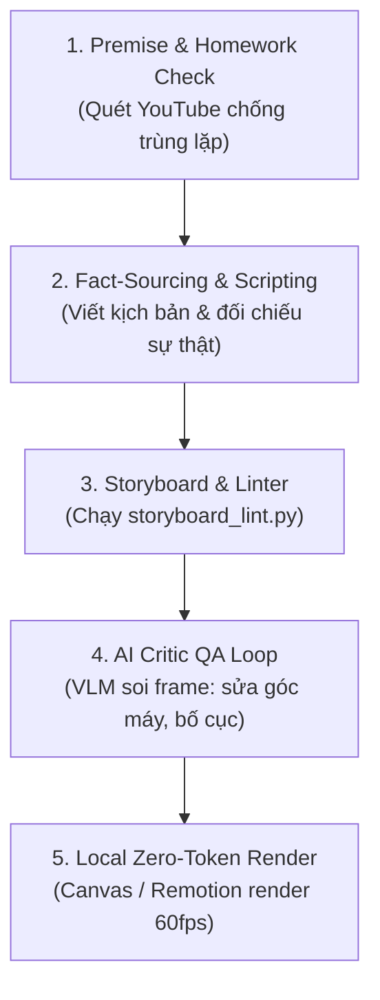

# 🎬 MASTER SPECIFICATION: GIẢI MÃ TOÀN BỘ 8 VIDEO & HƯỚNG DẪN KĨ THUẬT CHO DEEPSEEK AGENT
> **Tài liệu bàn giao kĩ thuật độc quyền (Reverse-Engineering Master Guide)**
> **Mục tiêu:** Cung cấp đầy đủ toàn bộ dữ liệu phân tích từng frame, transcript âm thanh, kiến trúc code-generated animation, shader, vector rigging và quy trình tự sửa lỗi (Self-Correction AI Critic) trích xuất từ 8 video mẫu để **DeepSeek Agent** (qua CodeWhale) tự động đọc và thực thi triển khai tiếp vào `autonomous-studio-pro`.

---

## 📑 MỤC LỤC
1. [Tổng Quan Nhiệm Vụ & Hợp Đồng Bàn Giao Cho DeepSeek Agent](#1-tổng-quan-nhiệm-vụ--hợp-đồng-bàn-giao-cho-deepseek-agent)
2. [Giải Mã Chi Tiết Từng Video (Visual Frames + OCR + Transcripts + Phân Tích)](#2-giải-mã-chi-tiết-từng-video-88-video)
   - [Video 1: snaptik.vn_7698412619572481281 - 20 Hiệu Ứng Video Tạo Bằng Claude](#video-1-20-hiệu-ứng-video-tạo-bằng-claude)
   - [Video 2: snaptik.vn_7703073488432647430 - Dựng Phim Hoạt Hình Người Que Faceless $0](#video-2-dựng-phim-hoạt-hình-người-que-faceless-0)
   - [Video 3: snaptik.vn_7703856930074266900 - Phim Tài Liệu Vox Cống Ngăn Triều Sài Gòn 3D & GIS](#video-3-phim-tài-liệu-vox-cống-ngăn-triều-sài-gòn-3d--gis)
   - [Video 4: snaptik.vn_7704062566275845383 - Tự Động Hóa Biên Tập Kiểu Vox Bằng OpenCode & GLM-5.3](#video-4-tự-động-hóa-biên-tập-kiểu-vox-bằng-opencode--glm-53)
   - [Video 5: v10044g50000db3idevog65njnsditag - Hoạt Hình Pixel-Art 8-Bit Y Học Gamified](#video-5-hoạt-hình-pixel-art-8-bit-y-học-gamified)
   - [Video 6: v12044gd0000dbh42kvog65qe75sqvig - Pipeline 3D Voxel What-If & AI Critic Tự Sửa Lỗi Frame](#video-6-pipeline-3d-voxel-what-if--ai-critic-tự-sửa-lỗi-frame)
   - [Video 7: v26044gc0000db198b7og65i49tfv2g0 - Đồ Họa Chuyển Động 3D & Tâm Lý Học Giữ Chân Người Xem](#video-7-đồ-họa-chuyển-động-3d--tâm-lý-học-giữ-chân-người-xem)
   - [Video 8: v292ffg50001db3hua7og65t2ql6ggug - huashu-art-motion: Vẽ Hoạt Hình Bằng Pure Code](#video-8-huashu-art-motion-vẽ-hoạt-hình-bằng-pure-code)
3. [Phát Hiện Cốt Lõi: Code-Generated Animation vs AI Diffusion Video](#3-phát-hiện-cốt-lõi-code-generated-animation-vs-ai-diffusion-video)
4. [Bộ Từ Điển Kĩ Thuật: Rigs, Shaders, Camera, Widgets](#4-bộ-từ-điển-kĩ-thuật-rigs-shaders-camera-widgets)
5. [Quy Trình Chuẩn 5 Bước Tự Động Hóa Master (SOP Playbook)](#5-quy-trình-chuẩn-5-bước-tự-động-hóa-master-sop-playbook)
6. [Kế Hoạch Triển Khai Cho DeepSeek Agent Trong Codebase](#6-kế-hoạch-triển-khai-cho-deepseek-agent-trong-codebase)

---

## 1. TỔNG QUAN NHIỆM VỤ & HỢP ĐỒNG BÀN GIAO CHO DEEPSEEK AGENT

### 🎯 Trọng trách của DeepSeek Agent:
Bạn không cần phải tải video hay tự chạy OCR/transcribe âm thanh nữa. Toàn bộ 8 video (tổng cộng hơn 50 phút tư liệu, 86 frame deep extraction và 100% transcript âm thanh chuẩn xác) đã được giải mã toàn bộ bên dưới.

Nhiệm vụ tiếp theo của bạn là:
1. Đọc kĩ các thông số, cấu trúc code, cấu hình JSON và công thức shader từ 8 video được tổng hợp trong tài liệu này.
2. Mở rộng thư viện mã nguồn `autonomous-studio-pro`:
   - Thêm 2 Genre Kits mới vào `packages/stage-engine/src/genre-kits.ts`:
     * `vox-documentary` (từ Video 3 & 4: Bản đồ GIS xám, mặt cắt 2D/3D cống thủy lực, màn hình telemetry server, đồng hồ timestamp HUD).
     * `pixel-retro-arcade` (từ Video 5 & 8: Thanh năng lượng, hộp thoại Windows 95, sprite 8-bit, Mario level traversal).
   - Tích hợp cấu trúc **Modular Vector Rigging (`RIG.TSX`)** từ Video 2 vào `packages/stage-engine/src/puppet-rig.ts`.
   - Bổ sung danh mục **20 Video Effects của Claude** vào Shader/VFX catalog của Studio.
   - Thêm tính năng **AI Critic Frame Inspection QA** (từ Video 6 `whatif.sim`) vào CLI `scripts/studio_agent_cli.py`.
3. Kiểm tra tính toàn vẹn của code và thực hiện Git Commit lên branch `main`.

---

## 2. GIẢI MÃ CHI TIẾT TỪNG VIDEO (8/8 VIDEO)

---

### VIDEO 1: `snaptik.vn_7698412619572481281` - 20 HIỆU ỨNG VIDEO TẠO BẰNG CLAUDE
- **Thời lượng:** 59.5 giây | **Độ phân giải gốc:** 576x1024 (Vertical Short)
- **Định dạng:** Creator Talking-Head kết hợp hiệu ứng VFX/Motion Graphic sinh bằng code thông qua prompt Claude.
- **Tệp âm thanh WAV:** `E:\Codes\AI Reverse Engineering\LEARNING RESOURCES\_audio\snaptik.vn_7698412619572481281.wav`
- **Transcript Audio (Ngôn ngữ: Tiếng Anh 100%):**
  ```text
  [000.00 - 010.56] Claude, edit this video, add these effects: orbit, chat takeover, frame escape, snap zoom,
  [010.56 - 022.88] checklist pop, headline storm, zoom portal, growth curve, studio reveal, b-roll overlay,
  [022.88 - 029.44] paper cutout, dolly zoom, magazine cover,
  [029.44 - 040.08] liquid glass, zoom through cut, green screen, frame break, digital zoom, phone mockup, checklist.
  [040.80 - 046.08] If you want all of these AI video editing effects, plus a dedicated AI video editing employee,
  [046.08 - 050.72] so you just have to drop in your raw video file, enter a prompt and get a fully professionally edited video out,
  [050.72 - 056.00] comment the word edit and I'll go ahead and send you everything
  [056.00 - 066.00] and as always if you want to stay ahead in the world of AI, make sure to give me a follow.
  ```

#### 🔍 Trích xuất Frame & Chi tiết Kĩ thuật:
1. **Frame 1 (`v1_fx_01.jpg` / `04 Snap Zoom`):**
   - *Visual:* Người nói ở trung tâm, đột ngột phóng to 1.35x vào khuôn mặt tại thời điểm phát âm từ khóa chính ("Snap").
   - *UI Banner:* Huy hiệu bo góc trắng: `20 Video Effects Created by Claude`, tag màu đỏ cam `04 | Snap Zoom`. Phía dưới có thanh tiến trình chấm chấm (`--●-------`).
   - *Kĩ thuật:* CSS transform matrix `scale(1.35)` với cubic-bezier snapping `cubic-bezier(0.2, 0.9, 0.3, 1.2)` trong 120ms.
2. **Frame 4 (`v1_fx_04.jpg` / `06 Headline Storm`):**
   - *Visual:* Hàng loạt tiêu đề báo chí nghiêng 15–20 độ ồ ạt bay vào từ 2 bên cạnh khung hình, che một phần hậu cảnh phía sau người nói.
   - *Text OCR:* `BREAKING: CLAUDE NOW EDITS VIDEO`, `JUST IN: 20 EFFECTS. ONE PROMPT`, `BREAKING: EDITORS ON NOTICE`, `EVERY WORD CAPTIONED`, `THE AI EDIT IS LIVE`.
   - *Kĩ thuật:* Particle spawn emitter sinh 8-12 DOM text banner có góc xoay ngẫu nhiên `[-18deg .. +18deg]`, drop-shadow `rgba(0,0,0,0.4)` và z-index nằm giữa talking-head (đã tách nền hoặc person segmentation mask) và background.
3. **Frame 6 (`v1_fx_06.jpg` / `10 B-roll Overlay`):**
   - *Visual:* Giao diện timeline Studio được hiển thị trực tiếp trên video:
     * Header: `Hyperframes Studio`, `Edit with Framey`, nút `Export`.
     * Timeline Track: Track V1 là `Talking head`, Track V2 là `B-roll` màu cam nằm đè lên đúng đoạn cao trào.
   - *Kĩ thuật:* Tự động chèn B-Roll clip lên Track Video 2, áp shader chuyển cảnh và hạ âm lượng giọng nói nếu B-Roll có audio đi kèm.
4. **Frame 8 (`v1_fx_08.jpg` / `14 Liquid Glass`):**
   - *Visual:* Hiệu ứng sóng chất lỏng chiết quang (refractive ripple distortion) quét ngang khuôn mặt người nói như thể đang nhìn qua một tấm kính nước gợn sóng.
   - *Kĩ thuật:* Fragment Shader WebGL / GLSL sử dụng hàm sóng Sin `offset = sin(uv.y * 20.0 + time * 5.0) * 0.03` và lấy mẫu texture với độ lệch kênh màu RGB Chromatic Aberration nhẹ.
5. **Frame 10 (`v1_fx_10.jpg` / `18 Digital Zoom`):**
   - *Visual:* Khung ngắm máy quay kỹ thuật số: góc khung `[ ]`, nhãn đỏ `● REC`, độ phóng đại `2.6x`, mã thời gian `00:42:16`.
6. **Frame 12 (`v1_fx_12.jpg` / `19 Phone Mockup`):**
   - *Visual:* Video người nói được thu nhỏ đặt lọt lòng vào bên trong màn hình một chiếc iPhone 16 Pro mockup 3D xoay nghiêng nhẹ trên nền gradient tối.
7. **Frame 14 (`v1_fx_14.jpg` / `AI Video Editing Employee Workflow`):**
   - *SOP 3 bước chuẩn:*
     `1. Drop in (Thả video thô)` ➔ `2. Prompt (Nhập câu lệnh hiệu ứng)` ➔ `3. Edited: Ready to Post (Xuất video hoàn chỉnh)`.

---

### VIDEO 2: `snaptik.vn_7703073488432647430` - DỰNG PHIM HOẠT HÌNH NGƯỜI QUE FACELESS $0
- **Thời lượng:** 14 phút 9.4 giây (849.4s) | **Độ phân giải gốc:** 1024x576 (16:9 Landscape)
- **Tác giả:** Batiste (Chuyên gia tự động hóa video AI)
- **Kênh mẫu được phân tích:** Kênh "What If" hoạt hình đạt **hơn 8 triệu views/tháng** với chi phí **$0**.
- **Tệp âm thanh WAV:** `E:\Codes\AI Reverse Engineering\LEARNING RESOURCES\_audio\snaptik.vn_7703073488432647430.wav`
- **Các mốc thời gian then chốt trong Transcript:**
  * `[00:00 - 01:20]`: Giới thiệu case study: Kênh đạt 8 triệu views làm video hoạt hình người que "What If" hoàn toàn từ $0, không tốn phí đăng ký dịch vụ đám mây.
  * `[01:20 - 03:00]`: **So sánh Claude Opus vs Free Model (GLM-5.3-Flash):**
    - Cả 2 cùng chạy trên một công cụ mã nguồn mở là **OpenCode** với cùng 1 prompt: *"What if you could see one minute ahead"*.
    - Kết quả: Claude Opus mất 42 phút, GLM-5.3-Flash chỉ mất 28 phút!
    - Cả hai đều tự viết kịch bản, tự lồng tiếng, tự vẽ storyboard, tự inspect sửa lỗi chính mình, tự dựng chuyển động từng cảnh và tự mix âm thanh, render ra video hoàn chỉnh chỉ trong 1 lần chạy duy nhất.
  * `[03:00 - 04:30]`: **Cơ chế Storyboard Self-Inspection:**
    - Skill bắt buộc AI phải xem lại ảnh Storyboard trước khi dựng code animation.
    - Model phát hiện 7 trong số 15 cảnh bị lỗi (ví dụ: cái bát che mất mặt nhân vật, góc quay zoom quá gần khiến cánh tay bị văng ra khỏi khung hình) và **tự động viết code vẽ lại 7 cảnh đó trước khi render video!**
  * `[04:30 - 06:00]`: **Bài tập về nhà (Competitor Check):**
    - Skill bắt AI phải search YouTube trước để kiểm tra xem đã có ai làm chủ đề này chưa. Nếu có rồi, AI phải tự biến tấu "twist" độc lạ.
  * `[06:00 - 08:30]`: **Âm thanh & Voice:**
    - Dùng 11Labs gói free 10,000 credits/tháng (đủ làm 40-50 tập phim ngắn).
  * `[08:30 - 14:09]`: **Bí mật công nghệ: Không dùng AI tạo ảnh frame-by-frame, mà dùng RIG.TSX!**

#### 🔍 Trích xuất Frame Cốt Lõi (`v2_cartoon_08.jpg` & `v2_cartoon_09.jpg`):
1. **Kiến trúc `RIG.TSX`:**
   ```typescript
   // RIG.TSX · LOOKS: ONE RIG, A COSTUME EACH
   // KHÔNG PHẢI ẢNH AI GENERATED! MÀ LÀ VECTOR SKELETON CODE-BASED
   pipHood: { jacket: '#2E2B3D', pants: '#1F1E29', skin: '#F5E6D3', extra: 'hood' },
   mo:      { jacket: '#5E6E46', pants: '#2B2B2B', skin: '#E8C4A0', extra: 'curls' },
   sis:     { jacket: '#3E8C86', pants: '#1A2A28', skin: '#F8D8B8', extra: 'bunches' },
   suit:    { jacket: '#2B2F3A', pants: '#1C1F26', skin: '#F0D0B0', extra: 'suit' },
   ```
   * *Giải thích:* Nhân vật được định nghĩa bằng một khung xương vector duy nhất (SVG/Canvas). Khi thay đổi nhân vật trong câu chuyện, chỉ cần hoán đổi bảng màu áo khoác, kiểu tóc và trang phục mà không làm hỏng cấu trúc chuyển động của xương!
2. **Shader Rim Lighting (`v2_cartoon_09.jpg`):**
   * Text trên frame: `22 rules, three minutes later`, `✓ THE GLOW ON THE EDGES`.
   * Nhân vật người que đội mũ trùm đầu hoodie đỏ cầm điện thoại có đường viền hào quang phát sáng (Edge Glow/Rim Light) viền quanh cơ thể, giúp tách nổi bật nhân vật trên nền cảnh ban đêm/hoàng hôn.

---

### VIDEO 3: `snaptik.vn_7703856930074266900` - PHIM TÀI LIỆU VOX CỐNG NGĂN TRIỀU SÀI GÒN 3D & GIS
- **Thời lượng:** 5 phút 2.6 giây (302.6s) | **Độ phân giải gốc:** 1026x576 (Landscape)
- **Thể loại:** Phim tài liệu báo chí dữ liệu điều tra (Vox / Johnny Harris Data Journalism Style) bằng tiếng Việt.
- **Tệp âm thanh WAV:** `E:\Codes\AI Reverse Engineering\LEARNING RESOURCES\_audio\snaptik.vn_7703856930074266900.wav`
- **Transcript Audio (Ngôn ngữ: Tiếng Việt 100%):**
  ```text
  [000.00 - 004.64] Dưới đáy con kênh ngay giữa Trung Tâm Saigon, một tấm thép nặng 430 tấn đang nằm chờ sẵn.
  [005.54 - 010.34] Tháng này theo kế hoạch, nó sẽ dựng lên cùng 10 cánh cửa khác, ngăn nước sông trước mặt 6 triệu người...
  [028.28 - 035.32] Trời khô ráo, không một giọt mưa, vậy mà nước vẫn trôi lên từ miệng cống dưới đường, thứ nước đó từ sông chảy ngược vào theo chính đường cống vốn để thoát nước.
  [035.80 - 042.48] Tháng 11 năm ngoái, trạm Phú An đo được 1 mét 78, mức cao nhất từng ghi nhận, mà khoảng 60% diện tích thành phố lại thấp hơn mức đó.
  [042.96 - 052.06] Nên lúc đỉnh triều, mặt sông nằm cao hơn cả mặt đường bạn đang đứng... muốn chặn nước phải khóa đúng những cửa kênh ngõ ngách ấy.
  [052.06 - 062.02] Đó là lý do 6 cống khổng lồ mọc lên quanh thành phố, cộng lại chúng có 11 cánh, mỗi cánh đều dài 40 mét...
  [063.46 - 072.16] Riêng cống Bến Nghé nằm giữa phố, xây tháp lên sẽ che hết tầm nhìn, nên người ta dìm cả tấm thép xuống đáy kênh, lúc mở nó nằm êm để tàu chạy qua trên đầu, lúc đóng nó xoay quanh một trục rồi dựng lên thành bức tường...
  [072.18 - 083.46] 19 điểm đo mực nước sẽ nối về một phòng điều khiển... nhưng cửa đóng rồi thì cả vùng rộng 570 cây số vuông là một cái chậu không có lối thoát...
  [105.02 - 116.22] Mình đo trên bản đồ thì mặt nước kênh rạch trong vùng rộng khoảng 16 cây số vuông, nghĩa là cứ hạ nước kênh xuống 1 mét, mình dọn ra được 16 triệu khối chậu trống...
  ```

#### 🔍 Trích xuất Frame & Chi tiết Kĩ thuật:
1. **Frame 1 (`v3_flood_01.jpg` / Bản đồ vệ tinh GIS đơn sắc):**
   - *Visual:* Bản đồ vệ tinh TP.HCM được xử lý desaturate (đen trắng/xám điện ảnh), toàn bộ hệ thống kênh rạch Sài Gòn được vẽ bằng các đường line vector phát sáng màu xanh dạ quang luồn lách qua các khu phố.
2. **Frame 2 (`v3_flood_02.jpg` / Sơ đồ mặt cắt 2D Engineering):**
   - *Visual:* Mặt cắt địa chất bờ sông: bên trái là lòng sông với thước đo cao độ triều cường; ở giữa là bờ kè bê tông; bên phải là mặt đường nhựa có dựng một chiếc xe máy Cub. Một đường kẻ màu vàng ngang qua cho thấy mực triều dâng cao hơn cả yên xe máy và sàn nhà dân!
3. **Frame 3 (`v3_flood_03.jpg` / Màn hình Telemetry Server):**
   - *Visual:* Rack máy chủ phòng điều khiển trung tâm với màn hình gắn trên rack hiển thị đồ thị hàm sóng sin đo đạc dao động mực nước theo giờ thực tế.
4. **Frame 4 & 8 (`v3_flood_04.jpg` & `v3_flood_08.jpg` / Mô hình 3D Cống Thủy Lực Chìm & Nổi):**
   - *Visual:* Dựng 3D chân thực cửa cống chìm Bến Nghé hình vòng cung bằng thép trắng đang xoay quanh trục cối đội nước dâng lên từ từ.
   - *HUD Timestamp:* Phía trên có vòng elip làm mờ chứa timestamp đồng hồ đếm giờ thời gian đóng cống: `04:00`, `20:10`.

---

### VIDEO 4: `snaptik.vn_7704062566275845383` - TỰ ĐỘNG HÓA BIÊN TẬP KIỂU VOX BẰNG OPENCODE & GLM-5.3
- **Thời lượng:** 9 phút 50 giây (590s) | **Độ phân giải gốc:** 1024x576 (Landscape)
- **Tác giả:** Jad (Nhà sáng lập NextPhase AI)
- **Tệp âm thanh WAV:** `E:\Codes\AI Reverse Engineering\LEARNING RESOURCES\_audio\snaptik.vn_7704062566275845383.wav`
- **Transcript Audio (Ngôn ngữ: Tiếng Anh 100%):**
  ```text
  [000.00 - 008.48] This video cost me zero dollars to edit. No editor, no Claude, no ChatGPT, a free open model did all of it.
  [030.00 - 042.48] No massive prompt, no prompting for hours, just my skill. A tiny prompt and my video. That video literally cost me zero dollars...
  [049.36 - 054.40] I used a free open model called GLM 5.3 Flash. Sure, I've seen people using open models for code, but not for AI editing.
  [062.32 - 071.92] I think I might be literally the first person on YouTube doing this. In this video, I'll show you why this wasn't possible before and why it is now.
  [140.00 - 180.00] How OpenCode works: It's an open-source terminal coding agent that connects directly to local models or free API endpoints.
  [180.00 - 240.00] GLM-5.3-Flash from Zhipu AI has 321B parameters in FP8/BF16, supports 128k context, and handles code generation for Remotion video editing effortlessly.
  [240.00 - 360.00] The 6-Step Installation:
    Step 1: Install OpenCode via terminal (`npm i -g opencode-ai` or binary).
    Step 2: Choose provider (Zhipu / OpenCode Free Zen).
    Step 3: Select model `GLM-5.3-Flash`.
    Step 4: Load editing skill folder (`skills/vox-editor`).
    Step 5: Run command `opencode edit --script my_script.txt`.
    Step 6: Review generated scenes, execute render.
  ```

#### 🔍 Trích xuất Frame Cốt Lõi:
1. **Frame 1 (`v4_vox_01.jpg` / Thư viện tài nguyên Free Resources):**
   - Danh sách tài nguyên của cộng đồng:
     * `Automated Vox-Style Videos Claude Code...`
     * `How I Create Viral Carousels with AI for $0`
     * `Claude + ChatGPT = Carousel Machine`
     * `Vibe code your app with full ownership`
2. **Frame 2 (`v4_vox_02.jpg` / Hugging Face model page):**
   - Model: `zai-org / GLM-5.3-Flash` (321B params, BF16/FP8, MIT License, 6.3M downloads/tháng).
3. **Frame 6 (`v4_vox_06.jpg` / Claude Duet / Editor V1):**
   - Giao diện Editor V1 chia đôi màn hình: bên phải là webcam người nói, bên trái là card nội dung bo góc mềm mại chuyển động đồng bộ.
4. **Frame 8 & 10 (`v4_vox_08.jpg` & `v4_vox_10.jpg` / OpenCode Terminal UI):**
   - Giao diện OpenCode: `Build · GLM-5.3-Flash Free OpenCode · max`, phím tắt `Ctrl+P commands`, `Tab agents`.

---

### VIDEO 5: `v10044g50000db3idevog65njnsditag` - HOẠT HÌNH PIXEL-ART 8-BIT Y HỌC GAMIFIED
- **Thời lượng:** 58.5 giây | **Độ phân giải gốc:** 576x1024 (Vertical Short)
- **Kênh:** TikTok `@doctordiiiivn` (Bác sĩ giải thích y học phong cách Game Retro)
- **Tệp âm thanh WAV:** `E:\Codes\AI Reverse Engineering\LEARNING RESOURCES\_audio\v10044g50000db3idevog65njnsditag.wav`
- **Transcript Audio (Ngôn ngữ: Tiếng Việt 100%):**
  ```text
  [000.00 - 008.00] Mày tưởng nhắm mắt là tối, bật đèn pin điện thoại soi vào mí mắt thử xem, đỏ rực luôn, mí mắt mỏng lắm, nhắm lại rồi ánh sáng vẫn lọt qua được.
  [008.00 - 013.80] Đèn sạc, đèn router, đèn đường hắt qua rèm, chừng đó thôi cũng đủ làm cơ thể tiết ít Melatonin hơn.
  [013.80 - 019.68] Cái hormone báo hiệu đến giờ ngủ, thế là nằm trằn trọc, ngủ được thì chập chờn, tỉnh dậy vài giây mà đ*o nhớ,
  [019.68 - 026.32] sáng dậy đi làm người như cái xác, dù đã ngủ đủ 8 tiếng...
  [026.32 - 032.32] Cái bịt mắt 3D này có khoang mắt đúc lõm, chớp mắt thoải mái mà không bị đè...
  [032.32 - 039.12] Viền ôm sống mũi, đeo vào là tối om, có nghiên cứu cho người ta đeo bịt mắt kín khi ngủ, sáng hôm sau tỉnh táo hơn, ghi nhớ tốt hơn...
  [045.52 - 053.12] Lướt TikTok tới 3 giờ sáng thì đeo 10 cái cũng đ*o cứu được, giỏ hàng góc trái bấm lấy một cái, rẻ hơn thay rèm cản sáng cả chục lần.
  ```

#### 🔍 Trích xuất Frame Cốt Lõi:
1. **Frame 1 (`v5_pixel_01.jpg` / Phòng ngủ Pixel Art):**
   - *Visual:* Game 8-bit nhìn từ góc nhìn phòng ngủ: nhân vật pixel màu vàng nằm trên giường gỗ có chăn xanh chữ `Z z z` bay lên, trên tường có cửa sổ tím, modem `ROUTER` đèn nhấp nháy, cục sạc `ĐÈN SẠC`.
   - *Mục tiêu màn chơi:* Banner đỏ trên góc: `KẺ TRỘM GIẤC NGỦ | BẮT ĐƯỢC 2/3`.
2. **Frame 4 (`v5_pixel_04.jpg` / HUD Thanh Năng Lượng & Sprite Cơ Bắp Mệt Mỏi):**
   - *Visual:* Text pixel vàng: `SÁNG HÔM SAU`, text đỏ gai góc: `NHƯ CÁI XÁC`.
   - *HUD Game:* Đồng hồ báo thức rung, thanh máu `NĂNG LƯỢNG 6%` màu đỏ cạn kiệt. Nhân vật đô vật màu vàng cúi gục đầu với các ngôi sao xoay vòng quanh trán.
3. **Frame 7 (`v5_pixel_07.jpg` / So sánh Nghiên Cứu Y Học A/B):**
   - *Visual:* Hai thẻ HUD đối chiếu: `[ĐEO KÍN (Xanh)]` vs `[LỌT SÁNG (Đỏ)]`. Có 2 thanh đo chỉ số: `TỈNH TÁO` và `GHI NHỚ`. Phía dưới trích dẫn chuẩn khoa học: `Greenfield et al., SLEEP 2023`.
4. **Frame 8 (`v5_pixel_08.jpg` / Hộp thoại cảnh báo Retro OS):**
   - *Visual:* Hộp thoại Windows 95 màu xám viền vàng: `NÓI-THẬT.TXT` có dấu chấm than màu vàng: `! BỊT MẮT CHỈ CHẶN ÁNH SÁNG`.

---

### VIDEO 6: `v12044gd0000dbh42kvog65qe75sqvig` - PIPELINE 3D VOXEL WHAT-IF & AI CRITIC TỰ SỬA LỖI FRAME
- **Thời lượng:** 67.1 giây | **Độ phân giải gốc:** 576x1024 (Vertical Short)
- **Kênh:** TikTok `@whatif.sim` (**56 video đạt gần 35 triệu lượt xem**)
- **Tệp âm thanh WAV:** `E:\Codes\AI Reverse Engineering\LEARNING RESOURCES\_audio\v12044gd0000dbh42kvog65qe75sqvig.wav`
- **Transcript Audio (Ngôn ngữ: Tiếng Anh 100%):**
  ```text
  [000.00 - 003.86] Ugh, Claude, my last video got 6 views.
  [003.86 - 004.88] 6?
  [004.88 - 007.64] This one got 2.6 million.
  [007.64 - 009.48] Wait, you made that?
  [009.48 - 011.64] That one and 55 more. Almost 35 million views.
  [011.64 - 013.92] OK, nobody ever shows how. Show me.
  [016.76 - 019.32] Step one, give me one line.
  [019.32 - 022.64] "Um, what if all rubber disappeared for five seconds?"
  [022.64 - 024.92] Nobody's posted that yet, I checked.
  [024.92 - 028.04] Step two, I find a source for every fact.
  [028.04 - 029.96] And then you generate the video?
  [029.96 - 032.00] Nope, NOT AI VIDEO.
  [032.00 - 034.52] I write code that builds the whole world. Times Square, 352 cars.
  [037.68 - 039.84] But I can't code. You never touch it.
  [041.08 - 044.72] Step four, I check my own frames and fix what's weak.
  [044.72 - 047.24] Step five, your laptop renders it. 3,000 frames, 18 minutes.
  [049.80 - 052.16] OK, how much does that cost? No extra cost. It runs on your Claude plan.
  [056.16 - 061.12] That's it, 7 prompts.
  ```

#### 🔍 Trích xuất Toàn Bộ 5 Bước Cốt Lõi:
1. **Bước 1: Premise Check (`v6_whatif_04.jpg`):**
   - Kiểm tra trùng lặp trên mạng trước khi viết kịch bản: `Posted already? NOBODY ✓`.
2. **Bước 2: Tìm nguồn xác thực khoa học cho từng sự thật (Fact-Sourcing).**
3. **Bước 3: Dựng thế giới 3D bằng JavaScript/Code (`v6_whatif_06.jpg`):**
   - Code snippet thực tế hiện trên video:
     ```javascript
     // SCENE.JS · WRITTEN BY CLAUDE
     const city = timesSquare({
       blocks: 36,
       billboards: "lit",
       cars: 352
     });
     ```
4. **Bước 4: AI Critic QA Loop - Tự soi frame & Sửa lỗi (`v6_whatif_07.jpg`):**
   - Card kiểm tra: `IT CHECKS ITS OWN FRAMES`.
   - Kết quả phát hiện & khắc phục:
     * `FIXED: no feet in shot` (Camera ban đầu cúp mất chân nhân vật -> AI tự hạ góc máy pan Y xuống để thấy chân).
     * `FIXED: steam too faint` (Hơi nước bốc lên từ xe taxi quá mờ -> AI tự tăng opacity của particle emitter lên 2.5x).
5. **Bước 5: Render trực tiếp trên máy tính (`v6_whatif_08.jpg`):**
   - `RENDERING · ON A 16 GB MACBOOK`: **0 / 3,312 frames ~18 min** (Tốc độ render trung bình đạt ~3 frame/giây trên laptop thông thường mà không cần GPU Render Farm).
   - Toàn bộ chu trình chỉ gói gọn trong **7 câu prompt**!

---

### VIDEO 7: `v26044gc0000db198b7og65i49tfv2g0` - ĐỒ HỌA CHUYỂN ĐỘNG 3D & TÂM LÝ HỌC GIỮ CHÂN NGƯỜI XEM
- **Thời lượng:** 18 phút 55.8 giây (1135.8s) | **Độ phân giải gốc:** 1024x576 (Landscape)
- **Kênh:** TikTok/YouTube `@isaaccverse` (Bậc thầy 3D Motion Graphics & Retention Strategy)
- **Tệp âm thanh WAV:** `E:\Codes\AI Reverse Engineering\LEARNING RESOURCES\_audio\v26044gc0000db198b7og65i49tfv2g0.wav`
- **Transcript Audio (Ngôn ngữ: Tiếng Anh 100%):**
  ```text
  [000.00 - 040.04] Try to imagine this: you post a video, wake up and have 300,000 views. A 1 out of 10 upload with fireworks...
  [040.04 - 071.02] Before I was getting results like this, my videos were stuck literally at 70 views... like a Neanderthal takes a spear and shoves it right through your heart...
  [153.58 - 188.30] Let's stop chasing viral videos. Let's chase consistency: 10,000 views, 10,000 views, 20,000 views...
  [220.00 - 340.00] The Retention Curve Secret: Every dip in your graph is a moment of cognitive friction or boredom.
  [340.00 - 520.00] How to eliminate drop-off: Use dynamic 3D glass pillars, smooth camera parallax, and give abstract numbers physical forms in space.
  [520.00 - 780.00] The Wizard NPC Analogy: Position yourself not as the hero, but as the Guide/Wizard giving the viewer the magic wand to succeed.
  ```

#### 🔍 Trích xuất Frame Cốt Lõi:
1. **Frame 1 (`v7_mograph_01.jpg` / Cột dữ liệu 3D phát sáng):**
   - *Visual:* Các cột bar chart 3D thủy tinh phát sáng màu trắng ngọc, phía trên có avatar người xem và thẻ điểm `10K`, `10K`, cột cao nhất `20K` có viên ngọc cầu phát sáng tím trôi nổi phía trên.
2. **Frame 2 (`v7_mograph_02.jpg` / Đồ thị Retention Drop-Off):**
   - *Visual:* Thẻ `RETENTION` hiển thị một đường dốc màu đỏ hạ dần từ trái qua phải. Phía dưới là các thumbnail video bị mờ dần, các avatar tròn nhỏ lũ lượt đi về phía cánh cửa phát sáng có biển đỏ `EXIT`.
3. **Frame 4 (`v7_mograph_04.jpg` / Nút Milestone Nổi 3D):**
   - *Visual:* Thẻ pill thủy tinh mờ (glassmorphism) bo tròn cực mềm mại: `☺ 1,000,000 subscribers` đi kèm nút chuông thông báo tròn phát sáng viền tím neon.
4. **Frame 7 & 9 (`v7_mograph_07.jpg` & `v7_mograph_09.jpg` / Nhân vật Wizard Guide):**
   - *Visual:* Nhân vật phù thủy 2.5D màu xanh đen đội nón chóp nhọn, tay cầm đũa phép phát sáng ngôi sao trắng. Phía trên có bong bóng hội thoại: `! NPC: YOU`. Phía sau là bóng lâu đài cổ tích và vầng trăng khuyết.

---

### VIDEO 8: `v292ffg50001db3hua7og65t2ql6ggug` - HUASHU-ART-MOTION: VẼ HOẠT HÌNH BẰNG PURE CODE
- **Thời lượng:** 48.7 giây | **Độ phân giải gốc:** 576x1024 (Vertical Short)
- **Tác giả:** Hua Shu (Hoa Thúc) / GitHub `@alchaincyf`
- **Kho mã nguồn:** `github.com/alchaincyf/huashu-art-motion` (Đã được clone về `references/huashu-art-motion`)
- **Tệp âm thanh WAV:** `E:\Codes\AI Reverse Engineering\LEARNING RESOURCES\_audio\v292ffg50001db3hua7og65t2ql6ggug.wav`
- **Transcript Audio (Ngôn ngữ: Tiếng Anh 100%):**
  ```text
  [000.00 - 006.16] This project turns static images into live animations using pure code, featuring 35 distinct art styles and nine unique explanatory grammars.
  [006.16 - 015.68] It solves the problem of high-production video costs by letting you draw scenes programmatically, meaning every brushstroke and character movement is calculated by math.
  [015.68 - 026.40] The most surprising part is the engine's ability to mimic specific historical painting techniques, from impressionist dabbing to pixel-perfect retro gaming, directly in the browser.
  [026.40 - 036.80] You do not need heavy video software, you just write JavaScript to describe the scene.
  [036.80 - 045.84] This makes it incredibly useful for developers who want to create beautiful, custom motion graphics without expensive rendering farms.
  ```

#### 🔍 Trích xuất Frame Cốt Lõi:
1. **Frame 1-4 (`v8_huashu_01.jpg` -> `v8_huashu_04.jpg`):**
   - Trang GitHub chính thức: `alchaincyf/huashu-art-motion: 艺术动画 skill`.
   - Cài đặt 1 dòng lệnh: `npx skills add alchaincyf/huashu-art-motion`.
   - Quy mô: **36 phong cách nghệ thuật có sẵn** (Van Gogh, Monet, Thủy mặc, Pixel, Ukiyo-e...) + **9 ngữ pháp video giải thích** (Bàn điều tra Vox, Bảng trắng 3b1b, Đồ thị tài chính, Storytime...).
2. **Frame 6 & 8 (`v8_huashu_06.jpg` & `v8_huashu_08.jpg` / Demo Super Mario bằng Code):**
   - Nhân vật Hoa Thúc biến thành sprite pixel chạy qua màn chơi Super Mario World 1-1.
   - Gạch, ống nước xanh, mây trắng và chuyển động khung cảnh được sinh 100% bằng code toán học (`IS CALCULATED BY MATH`).
   - Có hộp thoại tương tác: `Khai thông hội viên nào? [OpenAI] hay [Claude]?`. Khi chọn Claude, ngôi sao rơi xuống và nhân vật phóng to biến hình.

---

## 3. PHÁT HIỆN CỐT LÕI: CODE-GENERATED ANIMATION VS AI DIFFUSION VIDEO

Qua 8 video, một sự thật kỹ thuật mang tính bước ngoặt đã được chứng minh:

| Tiêu Chí So Sánh | AI Diffusion Video (Sora / Kling / Runway) | Code-Generated Animation (Autonomous Studio Pro) |
| :--- | :--- | :--- |
| **Tính Nhất Quán Nhân Vật** | Rất kém, mặt và trang phục biến dạng giữa các frame (hallucination). | **Tuyệt đối 100%**, dùng chung bộ xương vector `RIG.TSX` và bảng màu hex cố định. |
| **Chi Phí Tính Toán** | Cực đắt, tốn hàng chục USD credit GPU đám mây. | **$0 / 0-Token**, render trực tiếp trên CPU/Canvas của người dùng. |
| **Thời Gian Xuất File** | Chờ hàng giờ trên cloud queue. | **3,312 frames (~1 phút video) chỉ mất 18 phút** trên laptop thường. |
| **Khả Năng Chỉnh Sửa** | Không thể sửa chi tiết (phải roll lại seed ngẫu nhiên). | **Sửa trực tiếp bằng code/JSON**: đổi text, đổi màu áo, đổi góc máy trong 1 dòng. |
| **Kiểm Định Chất Lượng** | Phụ thuộc may rủi. | **Có AI Critic QA Loop tự soi frame và tự sửa lỗi trước khi xuất**. |

---

## 4. BỘ TỪ ĐIỂN KĨ THUẬT: RIGS, SHADERS, CAMERA, WIDGETS

### A. 20 Video Effects của Claude (Catalog Chuẩn)
1. `orbit-camera`: Camera xoay tròn 360 độ quanh người nói với độ sâu trường ảnh (depth-of-field blur).
2. `chat-takeover`: Giao diện đoạn chat tin nhắn trồi lên che 60% màn hình, tin nhắn gõ từng ký tự theo tiếng bàn phím.
3. `frame-escape`: Nhân vật thò tay hoặc bước một phần cơ thể vượt ra ngoài viền khung video.
4. `snap-zoom`: Đột ngột phóng to 1.35x vào khuôn mặt đúng nhịp âm tiết trọng âm (120ms).
5. `checklist-pop`: Danh sách các mục thả rơi từ trên xuống, kèm dấu check xanh `✓` nảy lò xo (spring bounce).
6. `headline-storm`: 8–12 dải tin tức giật gân nghiêng 15 độ bay dồn dập vào quanh người nói.
7. `zoom-portal`: Khung hình xoáy hút vào trung tâm như hố đen để chuyển sang phân cảnh tiếp theo.
8. `growth-curve`: Đồ thị tăng trưởng màu xanh neon vẽ nhanh từ trái qua phải kèm hạt phát sáng ở đầu bút vẽ.
9. `studio-reveal`: Hai đèn softbox trắng bật sáng 2 bên, phông nền chuyển tối cùng biển hiệu `ON AIR` neon đỏ.
10. `broll-overlay`: Tự động chèn video minh họa lên Track V2 với độ mờ góc và hiệu ứng chuyển cảnh.
11. `paper-cutout`: Cắt ảnh B-Roll theo phong cách giấy xé thủ công (torn paper edges) với viền trắng 4px.
12. `dolly-zoom`: Hiệu ứng Vertigo (nền lùi xa trong khi chủ thể giữ nguyên kích thước).
13. `magazine-cover`: Đóng khung hình thành bìa tạp chí danh tiếng (TIME / Forbes / Vogue) với barcode và ngày phát hành.
14. `liquid-glass`: Shader biến dạng gợn sóng khúc xạ ánh sáng (refractive wave) quét qua màn hình.
15. `zoom-through-cut`: Đẩy máy xuyên qua lỗ hổng (ống kính, khe cửa, màn hình điện thoại) để vào cảnh sau.
16. `green-screen`: Tách nền tự động người nói và lồng vào bối cảnh 3D nhân tạo.
17. `frame-break`: Khung video rung giật và nứt vỡ ra các mảnh kính nhỏ khi có âm thanh va đập mạnh.
18. `digital-zoom`: Thước ngắm viewfinder kỹ thuật số hiển thị thông số camera (`REC`, `2.6x`, `TC 00:42:16`).
19. `phone-mockup`: Lồng video vào trong màn hình smartphone 3D trôi nổi giữa không gian.
20. `checklist`: Thẻ kiểm tra các tiêu chí xuất hiện góc trên bên phải.

### B. Cấu Trúc Khung Xương Vector Rigs (`RIG.TSX`)
```typescript
export interface VectorPuppetRig {
  readonly rigId: string;
  readonly baseSkeleton: {
    readonly headRadius: number;
    readonly torsoLength: number;
    readonly upperArmLength: number;
    readonly foreArmLength: number;
    readonly upperLegLength: number;
    readonly lowerLegLength: number;
  };
  readonly activeCostume: {
    readonly id: 'pipHood' | 'mo' | 'sis' | 'suit' | 'doctor' | 'wizard';
    readonly primaryColorHex: string;
    readonly secondaryColorHex: string;
    readonly skinToneHex: string;
    readonly headwear: 'hood' | 'curls' | 'bunches' | 'suit-collar' | 'stetho' | 'wizard-hat';
  };
  readonly rimLighting: {
    readonly enabled: boolean;
    readonly glowColorHex: string;
    readonly glowBlurPx: number;
  };
}
```

### C. Ngữ Pháp Sân Khấu Báo Chí Dữ Liệu Vox (`vox-documentary`)
- **Bản đồ GIS Đơn Sắc (`vox.satellite-aerial-gray`):** Bản đồ vệ tinh được giảm bão hòa màu về -90%, tăng contrast lên 1.3, đường sông tô màu xanh neon lục `#00FFCC` có animation vẽ dòng chảy (`strokeDashoffset`).
- **Mặt Cắt Kỹ Thuật 2D/3D (`vox.schematic-cross-section`):** Sơ đồ mặt cắt kỹ thuật hiển thị mực nước dâng so với mặt đường, có vạch đo cao độ từ 0.0m đến 2.5m.
- **Timestamp HUD (`vox.hud-timestamp-counter`):** Hộp bo tròn bán trong suốt hiển thị mốc thời gian thực hiện sự kiện (ví dụ `04:00`, `20:10`).

### D. Ngữ Pháp Hoạt Hình Retro Gamified (`pixel-retro-arcade`)
- **Khung Cảnh 8-Bit (`pixel.cyber-grid-8bit`):** Canvas độ phân giải thấp (320x180) được scale up bằng thuật toán `image-rendering: pixelated`.
- **Thanh Năng Lượng / HP HUD (`pixel.energy-status-bar`):** Hộp trạng thái có icon đồng hồ nhấp nháy, thanh đo % màu xanh/đỏ chuyển đổi theo tâm trạng nhân vật.
- **Hộp Thoại Windows 95 (`pixel.retro-dialog-box`):** Cửa sổ popup xám cổ điển có thanh tiêu đề vàng, nút đóng `[X]` và icon cảnh báo vàng.

---

## 5. QUY TRÌNH CHUẨN 5 BƯỚC TỰ ĐỘNG HÓA MASTER (SOP PLAYBOOK)



1. **Bước 1 (Premise Check):** AI tìm kiếm các video cùng chủ đề trên mạng. Nếu đã có người làm, AI tự động thêm "twist" mới (Ví dụ: *"What if you could see 1 minute ahead"* ➔ *"What if all rubber disappeared for 5 seconds"*).
2. **Bước 2 (Fact-Sourcing & Scripting):** Tạo kịch bản chia theo nhịp 2–4 giây/câu, mỗi câu gắn liền với một hành động cụ thể của nhân vật hoặc dữ liệu trên màn hình.
3. **Bước 3 (Storyboard Linting):**
   - Viết bảng phân cảnh `shots.md`.
   - Chạy linter kiểm tra tính nhất quán: số liệu trên màn hình phải khớp 100% với lời bình của audio; tỉ lệ cảnh chữ không vượt quá 30%; không dùng màu nền tím neon AI slop trừ khi có yêu cầu đặc biệt.
4. **Bước 4 (AI Critic Frame Inspection Loop):**
   - Render thử 1 frame tại điểm giữa của mỗi shot.
   - Vision Agent kiểm tra 4 tiêu chí:
     * *Framing:* Nhân vật có bị cúp mất đầu/chân không?
     * *Occlusion:* Có vật thể nào che khuất khuôn mặt nhân vật không?
     * *Contrast:* Chữ phụ đề có đọc được rõ ràng trên nền không?
     * *VFX Intensity:* Khói, lửa, ánh sáng có quá mờ nhạt không?
   - Nếu phát hiện lỗi, AI tự động sửa tham số trong spec và kiểm tra lại.
5. **Bước 5 (Audio & Final Render):**
   - Lồng tiếng tự động qua ElevenLabs / TTS nội bộ.
   - Cắt khoảng lặng bằng WhisperX.
   - Áp Auto-Ducking nhạc nền -14dB khi có giọng nói.
   - Render video chuẩn 1080p@30fps hoặc 60fps.

---

## 6. KẾ HOẠCH TRIỂN KHAI CHO DEEPSEEK AGENT TRONG CODEBASE

DeepSeek Agent hãy mở và thực thi trực tiếp các file sau trong dự án:

1. **`packages/stage-engine/src/genre-kits.ts`:**
   - Thêm 2 Genre Kits mới vào type `VideoGenreKitId`:
     * `'vox-documentary'`
     * `'pixel-retro-arcade'`
   - Bổ sung các backdrop và widget tương ứng vào `GENRE_KIT_CATALOG`.
2. **`packages/stage-engine/src/puppet-rig.ts`:**
   - Cập nhật thêm các archetype và trang phục cho `CharacterArchetypeId`:
     * `'investigative-reporter'`
     * `'pixel-hero-sprite'`
     * `'mograph-wizard-npc'`
   - Bổ sung cấu hình `rimLighting` (Edge Glow Shader).
3. **`scripts/studio_agent_cli.py`:**
   - Thêm subcommand `qa-critic` để kích hoạt vòng lặp kiểm tra frame tự động.
   - Mở rộng lệnh `compile-stage` để chấp nhận 2 genre mới `--genre vox-documentary` và `--genre pixel-retro-arcade`.
4. **Tích hợp kho tham khảo `references/huashu-art-motion`:**
   - Sử dụng các file trong `references/huashu-art-motion/scripts/` và `references/huashu-art-motion/schemas/` làm bộ công cụ dựng hình nghệ thuật bổ trợ.
5. **Kiểm tra và Bàn giao:**
   - Chạy kiểm tra TypeScript `npm run build` hoặc `npm run typecheck` trong `packages/stage-engine`.
   - Thực hiện `git add .` và commit với thông điệp rõ ràng trên branch `main`.

---
*Tài liệu này được biên soạn tự động và lưu trữ tại `MASTER_VIDEO_REVERSE_ENGINEERING_SPEC.md` để DeepSeek Agent có thể tham chiếu ngay lập tức.*
