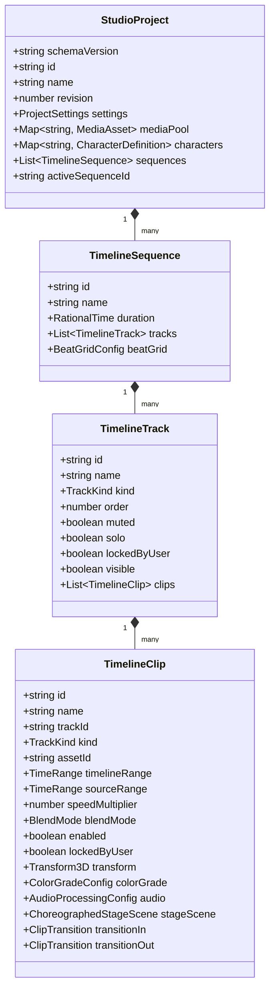

# 📐 UNIFIED PROJECT MODEL SPECIFICATION (`PROJECT_MODEL.md`)

> **Document Version:** 2.0.0  
> **Target Schema:** `packages/core-schema/src/timeline.ts`  
> **Status:** Authoritative Specification  

---

## 1. TEMPORAL FOUNDATION: RATIONAL TIME & TICK ARITHMETIC

Floating-point representations of time (such as IEEE-754 `f32` or `f64` seconds) suffer from cumulative rounding errors when performing repeated splits, ripples, and frame lookups. At 29.97 fps (NTSC) or 59.94 fps, floating-point math inevitably causes visual jitter, audio-video desync, and off-by-one frame trimming artifacts.

Autonomous Studio Pro strictly mandates **Rational Time** for all temporal coordinates:

```typescript
export interface RationalTime {
  /** Signed 64-bit integer numerator (frame ticks) */
  readonly value: number;
  /** Positive non-zero integer denominator (ticks per second, e.g., 60, 24000, 48000) */
  readonly rate: number;
}

export interface TimeRange {
  /** Inclusive starting point on the master or source timeline */
  readonly startTime: RationalTime;
  /** Non-negative duration of the span */
  readonly duration: RationalTime;
}
```

### Invariant Rules for Rational Time:
1. **Canonical Simplification:** Every time operation reduces the fraction to lowest terms using the Greatest Common Divisor (GCD):
   $$\text{reduce}(v, r) = \left( \frac{v}{\gcd(|v|, r)}, \frac{r}{\gcd(|v|, r)} \right)$$
2. **Standard Internal Rate:** By default, visual timelines operate at a common display rate (e.g. $60$ ticks/sec), while audio operations operate at $48{,}000$ ticks/sec. Time conversions between rates maintain integer exactness:
   $$\text{rescale}(t, r_{\text{new}}) = \text{round}\left( \frac{t.\text{value} \times r_{\text{new}}}{t.\text{rate}} \right)$$
3. **Strict Range Invariants:**
   - $duration.value \ge 0$. Negative durations are rejected by schema validation.
   - For any clip, its end timestamp is uniquely computed as:
     $$endTime = startTime + duration$$

---

## 2. PROJECT HIERARCHY & DOCUMENT AST

The top-level root of a video project is the `StudioProject` document. In Version 2.0, the schema supports multi-sequence projects, explicit gap handling, and revision tracking for optimistic concurrency.



---

## 3. TRACK KINDS & STACKING SEMANTICS

Tracks are evaluated from bottom to top according to their `order` integer (higher order = rendered on top):

| Track Kind | Priority / Typical Order | Purpose | Primary Media / Payload |
| :--- | :---: | :--- | :--- |
| `caption` | 50 | Animated word-level kinetic subtitles (Hormozi / CapCut) | `DynamicCaptionPayload` (WhisperX tokens) |
| `motion-code` | 40 | Procedural React/Canvas templates (Motifs, KPIs, Lower-Thirds) | `MotionCodePayload` (Remotion-style components) |
| `stage-puppet` | 35 | Deterministic 2D Stickman & 2.5D Camera Rig scenes | `ChoreographedStageScene` (Move-sets, widgets) |
| `video` (B-Roll) | 30 | Secondary visual cutaways, stock video, news clips | `MediaAsset` (Video/Image/URL) + Depth Parallax |
| `video` (A-Roll) | 20 | Primary interview, narrative spine, main camera | `MediaAsset` (Raw footage, talking head) |
| `audio-voice` | 10 | Primary voiceover / dialogue (auto-ducking trigger) | Speech audio (`.wav`, `.mp3`, TTS output) |
| `audio-sfx` | 5 | Foley effects, impacts, whooshes, risers | Sound effects (MMAudio / sound library) |
| `audio-music` | 1 | Background music bed (auto-ducking target, -14dB) | BGM audio + Librosa beat-sync grid |

---

## 4. CLIPS, GAPS & TRANSITIONS

### 4.1 Gap Semantics
Timelines support both **Magnetic (Gapless)** and **Freeform (Track-based)** editing:
- In magnetic tracks, clips automatically abut their neighbors. Deleting a clip closes the gap unless ripple-shifting is explicitly disabled.
- In freeform tracks, empty spaces between clips represent implicit transparent gaps.
- When exporting to FFmpeg filtergraphs or native decoders, implicit gaps are deterministically materialized as black video (`color=c=black:d=...`) and silent audio (`anullsrc=d=...`).

### 4.2 Transitions
Transitions are attached directly to clip boundaries via `transitionIn` and `transitionOut`:

```typescript
export interface ClipTransition {
  readonly id: string;
  /** Shader ID from packages/shader-library (e.g. 'gl.directionalwipe', 'gl.swirl', 'capcut.whip-pan-blur') */
  readonly transitionShaderId: string;
  readonly duration: RationalTime;
  readonly easing: 'linear' | 'easeIn' | 'easeOut' | 'easeInOut' | 'cubicBezier';
  readonly params: Record<string, number | readonly number[] | string>;
  /** Optional linked audio SFX triggered at transition peak */
  readonly linkedSfxAssetId?: string;
}
```

---

## 5. COLOR GRADING & KEYFRAME ANIMATION

### 5.1 DaVinci Resolve-Style Color Grading
Every visual clip contains an embedded `ColorGradeConfig`:
```typescript
export interface ColorGradeConfig {
  readonly enabled: boolean;
  readonly exposure: AnimatableProperty<number>;    // [-3.0 .. +3.0] EV stops
  readonly contrast: AnimatableProperty<number>;    // [0.5 .. 2.0]
  readonly saturation: AnimatableProperty<number>;  // [0.0 .. 2.0]
  readonly temperature: AnimatableProperty<number>; // [-1.0 .. +1.0] (Cool to Warm)
  readonly tint: AnimatableProperty<number>;        // [-1.0 .. +1.0] (Green to Magenta)
  readonly lift: readonly [number, number, number, number];  // Shadows (RGBA)
  readonly gamma: readonly [number, number, number, number]; // Midtones (RGBA)
  readonly gain: readonly [number, number, number, number];  // Highlights (RGBA)
  readonly halationIntensity: AnimatableProperty<number>;     // [0.0 .. 1.0] Film glow bloom
  readonly filmGrainIntensity: AnimatableProperty<number>;    // [0.0 .. 1.0] 35mm grain simulation
}
```

### 5.2 Animatable Properties & Keyframes
Properties can be static or animated via keyframe tracks:
```typescript
export interface Keyframe<T> {
  readonly time: RationalTime;
  readonly value: T;
  readonly interpolation: 'linear' | 'hold' | 'bezier';
  readonly bezierHandles?: {
    readonly leftX: number;  readonly leftY: number;
    readonly rightX: number; readonly rightY: number;
  };
}

export interface AnimatableProperty<T> {
  readonly staticValue: T;
  readonly keyframes: readonly Keyframe<T>[];
}
```

---

## 6. REVISION CONTROL & CONCURRENCY METADATA

Every `StudioProject` maintains a strictly monotonically increasing integer:
$$\text{revision}_{n+1} = \text{revision}_n + 1$$
- When an AI agent or background task issues a mutation command, it includes `expectedRevision: revision_n`.
- If a user has made an edit in the meantime ($\text{currentRevision} > \text{expectedRevision}$), the Command Gateway rejects the command with a `CONCURRENCY_CONFLICT` error, preventing destructive overwrites.

