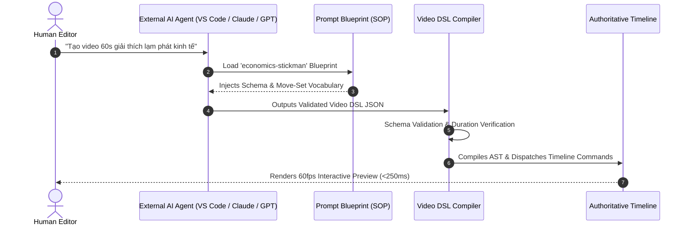

# 📜 VIDEO DSL SPECIFICATION v1.0 (`VIDEO_DSL_SPEC.md`)

> **Language Specification:** Declarative Video Domain-Specific Language (Video DSL)  
> **Schema Version:** `1.0.0`  
> **Purpose:** Formal intermediate representation (IR) between Natural Language AI Prompts and the Unified Project Model AST.  

---

## 1. PURPOSE & DESIGN PRINCIPLES

The Video DSL is a high-level, human-and-machine-readable declarative schema that describes a complete video production. Rather than having LLMs output messy multi-track timeline JSON with raw tick calculations, LLMs generate a **Video DSL Document**.

The **Video DSL Compiler** (`packages/core-schema/src/video-dsl.ts`) then deterministically transforms the DSL into a fully populated `StudioProject` AST with zero ambiguity.

### Key Principles:
1. **Separation of Intent and Execution:** The DSL captures *what* happens in the video (narration, shots, character actions, visual layers, sound cues), not the low-level pixel transforms or timeline track array indices.
2. **Deterministic Durations:** Each shot has an explicit `durationSec` or is bound to a narration segment, guaranteeing that shots sum up exactly to scene and video runtimes.
3. **Zero Token Waste:** Visual layers can reference pre-built move-sets, 2.5D camera rigs, and genre widgets that require 0 generative AI tokens to render.

---

## 2. FORMAL VIDEO DSL v1.0 JSON SCHEMA

A valid Video DSL document consists of 7 structured blocks:

```json
{
  "schemaVersion": "1.0.0",
  "metadata": {
    "id": "dsl_fed_interest_rates_001",
    "title": "Tại sao FED Tăng Lãi Suất Lại Gây Chấn Động Toàn Cầu?",
    "targetDurationSec": 60.0,
    "targetGenre": "economics-stickman",
    "autonomyTier": "tier-1-eco-puppeteer",
    "language": "vi",
    "aspectRatio": "16:9",
    "resolution": { "width": 1920, "height": 1080, "fps": 60 }
  },
  "scenes": [
    {
      "sceneId": "scene_01_hook",
      "index": 0,
      "goal": "Grab viewer attention within 3 seconds using dramatic hook and market crash visual",
      "narrationText": "Tại sao FED chỉ cần tăng 0.25% lãi suất mà hàng trăm tỷ đô bốc hơi?",
      "targetDurationSec": 4.5,
      "pacing": "fast-hook"
    }
  ],
  "shots": [
    {
      "shotId": "shot_01_01",
      "sceneId": "scene_01_hook",
      "durationSec": 4.5,
      "visualLayer": "stage-puppet",
      "framing": "medium-close",
      "cameraRig": "crash-zoom-face-punch",
      "transitionIn": { "type": "gl.directionalwipe", "durationSec": 0.3 }
    }
  ],
  "characterActions": [
    {
      "characterId": "stickman-economist",
      "shotId": "shot_01_01",
      "moveSetId": "econ-panic-head-grab",
      "expressionId": "shocked",
      "handProp": "pointer-stick",
      "speechBubble": "0.25% thôi mà!"
    }
  ],
  "composition": [
    {
      "shotId": "shot_01_01",
      "backdropId": "econ-bloomberg-dark",
      "widget": {
        "kind": "econ.stock-candlestick-crash",
        "params": { "crashPercent": 24.5, "redCandles": 5 }
      },
      "atmosphereParticles": "falling-dollar-bills"
    }
  ],
  "assetRequirements": [
    {
      "assetRefId": "broll_wall_street_trading",
      "shotId": "shot_01_01",
      "query": "Wall street stock market crash panic",
      "kind": "video",
      "aestheticScoreMin": 8.5,
      "licensePreference": "free-commercial",
      "fallbackAction": "use-procedural-widget"
    }
  ],
  "subtitleTiming": {
    "stylePreset": "hormozi-yellow-pop",
    "maxWordsPerScreen": 3,
    "highlightColor": "#FACC15",
    "fontFamily": "Montserrat Black"
  }
}
```

---

## 3. CORE SUB-ENTITIES & VOCABULARIES

### 3.1 Metadata & Autonomy Tiers
- `targetGenre`: `'economics-stickman'` | `'universe-cosmic'` | `'lore-chronicle'` | `'all-purpose-cinematic'`
- `autonomyTier`:
  - `tier-0-zero-ai`: 100% deterministic, pre-built move-sets, 0 tokens.
  - `tier-1-eco-puppeteer`: AI orchestrates pre-built rigs (<100 tokens/scene).
  - `tier-2-hybrid-pro`: Built-in stage + 20% neural B-roll/depth.
  - `tier-3-full-ai-max`: Complete neural generative pipeline.

### 3.2 Visual Layers & Stage Compositions
Every shot targets one of five visual layers:
1. `stage-puppet`: Interactive 2D stickman / character rig with skeletal poses.
2. `video-broll`: Neural or stock footage cutaway.
3. `motion-code`: Procedural React / Remotion-style graphic card.
4. `3d-model`: Three.js / wgpu 3D model with orbital camera.
5. `article-screenshot`: News headline callout with animated yellow highlighter.

### 3.3 Camera Rig Vocabulary (`cameraRig`)
- `static-stage-wide`: Fixed wide framing.
- `slow-push-in-dramatic`: Subtle forward dolly pushing into character.
- `slow-pull-out-reveal`: Pull back revealing broader stage context.
- `crash-zoom-face-punch`: Sudden 3x punch zoom on character face.
- `whip-pan-to-chart-right`: Rapid motion-blurred pan to the right-side chart.
- `orbital-3d-parallax-float`: Floating 2.5D multi-plane perspective drift.
- `dutch-tilt-crisis-shake`: Angled horizon with handheld micro-shake.

---

## 4. PROMPT BLUEPRINT MECHANISM

A **Prompt Blueprint** is a structured template that guides an LLM to generate valid Video DSL from human instructions.



### Compiler Verification Rules:
1. **Total Duration Match:** $\sum \text{shot}.\text{durationSec} = \text{metadata}.\text{targetDurationSec} \pm 0.5\text{s}$.
2. **Reference Integrity:** Every `shot.sceneId` must exist in `scenes`. Every `characterActions.shotId` must exist in `shots`.
3. **Graceful Asset Fallback:** If `assetRequirements` cannot be fulfilled (e.g. offline stock API), the compiler falls back to the specified procedural widget without halting compilation.

