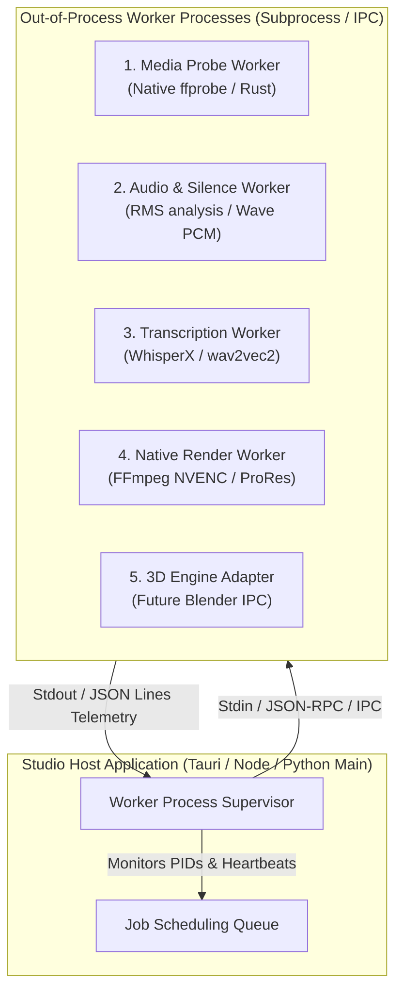

# ⚙️ ISOLATED WORKER PROCESS CONTRACTS (`WORKER_CONTRACTS.md`)

> **Document Version:** 2.0.0  
> **Target Subsystem:** Process Workers (`services/`, `apps/desktop/src-tauri/`, `scripts/`)  
> **Status:** Authoritative Specification  

---

## 1. ISOLATION PHILOSOPHY & PROCESS BOUNDARIES

Audio processing (WhisperX, Demucs), neural video models (SAM 2.1, Depth-Anything), and GPU video encoding (FFmpeg NVENC) involve native C/C++ libraries, PyTorch CUDA runtimes, and high memory footprints. Running these inside the main UI or Tauri process risks UI thread freezes, Python Global Interpreter Lock (GIL) contention, or outright segmentation faults from GPU driver crashes.

Therefore, **all heavy operations run as Isolated Process Workers**.



---

## 2. STANDARD WORKER PROTOCOL SPECIFICATION

Every worker conforms to a standard JSON-Lines protocol communicating over standard streams (`stdin` / `stdout`) or local Unix domain sockets / named pipes.

### 2.1 Worker Invocation Request
```json
{
  "protocolVersion": "1.0.0",
  "jobId": "job_audio_silence_98a72b",
  "workerType": "audio-silence-cut",
  "input": {
    "sourceAudioPath": "/projects/demo/audio.wav",
    "thresholdDb": -35.0,
    "minDurationSec": 0.4
  },
  "resourceLimits": {
    "timeoutSec": 60,
    "maxMemoryMb": 2048,
    "gpuDeviceIndex": 0
  }
}
```

### 2.2 Worker Progress Event (Streaming on Stdout)
```json
{
  "type": "PROGRESS",
  "jobId": "job_audio_silence_98a72b",
  "percent": 45.2,
  "stage": "computing_rms_windows",
  "processedFrames": 54000,
  "totalFrames": 120000,
  "etaSeconds": 3.2
}
```

### 2.3 Worker Completion Response
```json
{
  "type": "COMPLETED",
  "jobId": "job_audio_silence_98a72b",
  "durationMs": 4820,
  "output": {
    "detectedSilences": [
      { "startTimeSec": 2.14, "endTimeSec": 2.65, "durationSec": 0.51 },
      { "startTimeSec": 8.42, "endTimeSec": 9.10, "durationSec": 0.68 }
    ],
    "cleanVoiceRanges": [
      { "startTimeSec": 0.0, "endTimeSec": 2.14 },
      { "startTimeSec": 2.65, "endTimeSec": 8.42 }
    ]
  }
}
```

### 2.4 Worker Error Response
```json
{
  "type": "FAILED",
  "jobId": "job_audio_silence_98a72b",
  "errorCode": "AUDIO_CORRUPTED",
  "message": "Encountered invalid RIFF chunk header in source WAV file",
  "isRetryable": false,
  "stackTrace": "Traceback (most recent call last)..."
}
```

---

## 3. CORE WORKER CATALOG

### 3.1 Media Probe Worker (`MediaProbeWorker`)
- **Binary / Engine:** `ffprobe -v quiet -print_format json -show_format -show_streams`
- **Output:** Exact stream codec, width, height, sample rate, bit depth, frame count, rational framerate.
- **SLA:** $< 150\text{ ms}$ for local SSD files.

### 3.2 Audio & Silence Cut Worker (`AudioSilenceCutWorker`)
- **Binary / Engine:** Python standard `wave` + `struct` windowed RMS analyzer.
- **Output:** Array of silence timestamps and speech active ranges.
- **Fallback:** Returns default conversational breath boundaries if file is missing.

### 3.3 Transcription Worker (`TranscriptionWorker`)
- **Binary / Engine:** `WhisperX` with phoneme-level forced alignment.
- **Output:** Word-level timestamps, confidence scores, and emphasized keyword flags.

### 3.4 Native Render Worker (`NativeRenderWorker`)
- **Binary / Engine:** `ffmpeg` with NVIDIA NVENC (`h264_nvenc`, `hevc_nvenc`) / Apple `h264_videotoolbox` / `libx264`.
- **Output:** Master `.mp4` / `.mov` file, byte size, encoding FPS, and loudnorm audio verification report.

### 3.5 3D Engine Adapter Worker (`Blender3DAdapterWorker` — Future Expansion)
- **Binary / Engine:** Headless Blender (`blender --background --python render_rig.py`).
- **Contract:** Accepts camera trajectory and bone pose matrices; renders 2.5D multi-plane background passes or 3D GLTF asset turnarounds.

---

## 4. SUPERVISION, CANCELLATION & FAULT TOLERANCE

1. **Graceful Cancellation:** When a user cancels a job or adjusts timeline cuts, the supervisor sends an atomic `{"type": "CANCEL"}` command. If the worker does not exit within 1.0s, the supervisor terminates the process via `SIGKILL` and cleans up temporary scratch files.
2. **Crash Isolation:** If a worker segfaults, the supervisor catches the non-zero exit code, records the error into the DAG job state, and flags the clip in the UI as `FAILED_NEEDS_REVIEW` without dropping the user's active session.

